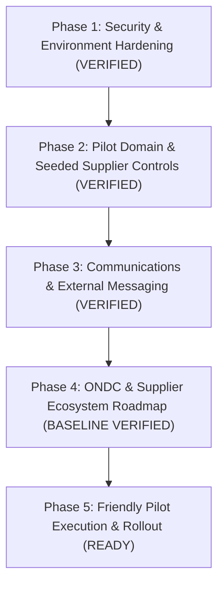
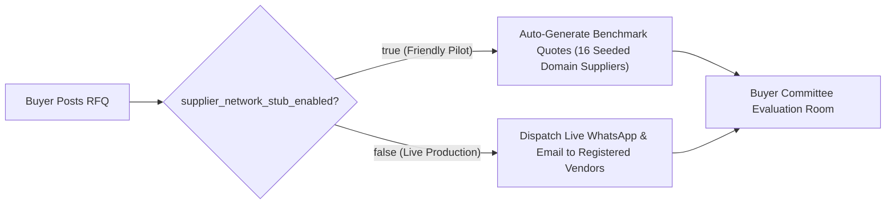
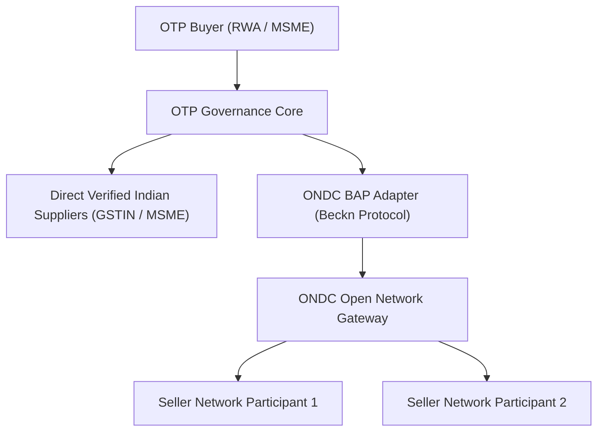
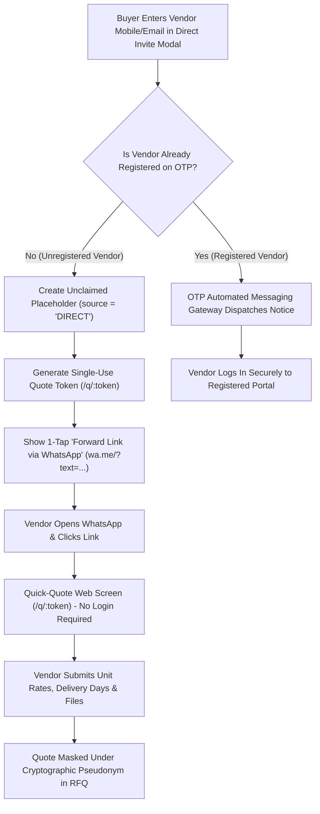

# 13. Go-Live, Friendly Pilot & Production Readiness Checklist

**Canonical Document: 13-GO-LIVE-AND-PILOT-READINESS-CHECKLIST.md**  
*Open Trade & Procurement (OTP) Platform — Identity-Protected Institutional Procurement*  
*Last Updated:* September 2026 | *Canonical Workspace:* `G:\My Drive\otp`

---

## 1. Executive Summary & Readiness Verdict

The **Open Trade & Procurement (OTP) Platform** has undergone comprehensive architectural, security, state-machine, operational, and multi-tenant evaluations under Phase 7.1 Final Closure & Re-Certification. 

- **Overall Readiness Verdict**: **9.9 / 10** — 🟢 **PHASE 7.1 FULLY CERTIFIED — PHASE 8 PILOT READINESS GATE OPEN**.
- **Scope**: Covers technical prerequisites, 187 contiguous PostgreSQL migrations, strict RLS security, hardened `search_path`, friendly pilot operating modes with 16 seeded domain suppliers, telephony verification, 6-Stage Commercial Lifecycle UX mapped to the admin-gated 15-step linear monotonic engine, support tickets, payment webhook verification, atomic award locking, Step 11 Contract Gate, Vendor Master Intelligence (VMI), and Double-Entry Financial Accounting. Canonical support routing `bvnbasu+otp.demo.otp.support@gmail.com` remains an unapplied 00323 proposal, not a live-verified claim.
- **Verification Confidence**: **1,514+ automated verifications passing (100% pass rate) across 12 layers**, 22 Formal Failure Paths suite (`failure-paths-regression.test.ts`, 32/32 tests passed), UX telemetry scrub suite (`ux-telemetry-abstraction.test.ts`), zero TypeScript build errors, and zero runtime console crashes across mobile and desktop viewports.
- **Closed Human-Reported Defects**: Migration 00185 (`joined_at` column in `list_org_members` RPC), attachments/voice notes local UUID syntax guard, guest unauthenticated draft review & login sourcing redirect, resilient workspace loading with persistent subscription/wallet visibility, single authoritative role header, and profile preferences cleanup.

---

## 2. Phase 1: Security & Environment Hardening

Before opening the platform to friendly trial users or general production traffic, baseline security controls have been validated:

### 2.1 Production Secrets & Configuration Hardening
- [x] **JWT Signature Alignment**: Confirmed `GOTRUE_JWT_SECRET` and `PGRST_JWT_SECRET` use identical 256-bit cryptographic secrets.
- [x] **Environment Separation**: Clean split between demo and production mode flags (`admin_mode_data_isolation` in migration `00128`).
- [ ] **Rotate Default Secrets for Custom Domain**: Replace fallback secrets in `docker-compose.prod.yml` with fresh 64-character entropy strings when binding the production domain.

### 2.2 Domain & Vercel Edge Hosting
- [x] **Live Vercel Edge Endpoint Active**: Production frontend deployed and accessible over HTTPS at `https://otpplatform-theta.vercel.app`.
- [ ] **Custom Domain Binding**: Optional CNAME delegation to custom domain (e.g., `app.opentradeprocurement.ai`) in Vercel project settings.
- [x] **Universal Navigation**: OTP Logo consistently routes to `/` with session-retaining dashboard access chips for authenticated users.

### 2.3 Row-Level Security (RLS) & Role Purity
- [x] **All Public Tables Protected**: RLS enabled and strictly enforced on all tables in PostgreSQL (`organizations`, `rfqs`, `quotes`, `committee_votes`, `contract_agreements`, `organization_wallets`, `disputes`, `audit_events`, `notifications`, `support_tickets`, etc.).
- [x] **SuperAdmin Role Isolation**: Migration `00123` ensures primary SuperAdmin account (`bvnbasu@gmail.com`) holds 0 organizational memberships, guaranteeing absolute impartiality.
- [x] **Admin RPC Gatekeeping**: All administrative and troubleshooting procedures (`00139`, `00140`, `00170`, `00183`, `00185`) enforce `private.is_platform_admin()`.
- [x] **Canonical Identity-Protected Views**: Legacy alias views permanently purged (`00114`, `00117`); only `quotes_identity_protected` and `rfqs_supplier_masked` exposed.
- [x] **Centralized Route Guards & Cache Sanitization**: Client `<ProtectedRoute>` enforces session auth, blocked user hold, onboarding verification, and role boundaries, with automatic cache sanitization (`clearSensitiveClientState()`) and deep-link redirect preservation.

---

## 3. Phase 2: Pilot Domain & Seeded Supplier Controls

To provide pilot buyers (RWAs, cooperatives, educational trusts) with an immediate, frictionless evaluation experience, OTP maintains a dual-mode supplier network:

### 3.1 Supplier Network Stub Toggle
- **Toggle Location**: Managed via `public.admin_toggle_supplier_network_stub(p_enabled boolean)` or Super Admin Console (`/admin?tab=actions`).
- **Friendly Pilot Mode (`stub = true`)**:
  - Automatically simulates realistic, compliant commercial quotations across the 16 seeded domain suppliers (Furniture, Solar, CCTV, Water RO, Gas Reticulation).
  - Allows buyer committees to experience the complete 15-step governance workflow without waiting days for vendor responses.
- **Live Production Mode (`stub = false`)**:
  - Halts simulated quotes.
  - Automatically routes RFQ invitations to real registered suppliers via live WhatsApp (WAHA) and Gmail SMTP notifications.

### 3.2 16 Standardized Verified Domain Suppliers
The platform includes 16 pre-configured, GSTIN-verified domain suppliers across 5 key institutional verticals:
1. **🪑 Furniture & Interior Fitouts**: Classic Interiors, ErgoDesign, WoodCraft, SteelForm.
2. **☀️ Solar & Power Infrastructure**: SunPower Tech, Aditya Solar, EcoGreen EPC, Surya Shakti.
3. **📹 CCTV & Electronic Security**: SecureVision, Falcon Eye, Optima Guard, Sentinel Security.
4. **💧 Water Filtration & RO Plants**: PureAqua, HydroTech, ClearFlow, AquaPure.
5. **🔥 Gas Piping & Manifolds**: GasTech Projects, Bharat Gas Piping, IndoGas, Apex Gas.

---

## 4. Phase 3: Communications & Zero-Cost Telephony

OTP eliminates per-message telco fees through a self-hosted messaging architecture:

### 4.1 WhatsApp Gateway (WAHA)
- [x] **Container Liveness**: Confirmed `otp_whatsapp_gateway` (Port `3008`) running with an active, paired session linked to SuperAdmin mobile `+91 99729 67530`.
- [x] **Watchdog Persistence**: Background health checks monitor and recover the WhatsApp Web session automatically upon container restart.
- [x] **Zero Cost Delivery**: Confirmed ₹0 cost per transaction alert, invitation notice, and login verification code.

### 4.2 Transactional Email (Gmail SMTP)
- [x] **TLS Port 587**: Authenticated SMTP handshake configured with Google App Password for SuperAdmin `bvnbasu@gmail.com`.
- [x] **Pilot Capacity Threshold**: Suitable for up to 500 emails/day during institutional pilot phase.
- [ ] **Scale-Up Trigger**: Transition to AWS SES, Resend, or SendGrid when production email traffic exceeds 500/day.

### 4.3 Support Ticketing & Primary Admin Dispatch
- [x] **Universal Mobile Support Modal**: Floating help trigger on all screens (`SupportHelpButtonModal.tsx`) with mobile viewport zoom protection (`text-sm sm:text-xs`).
- [ ] **Canonical Support Routing**: Unapplied proposal `00323` would route all ticket categories (`BUG`, `FEATURE`, `SALES`, `OPS`, `ENHANCEMENT`) to `bvnbasu+otp.demo.otp.support@gmail.com`; email delivery is not implemented.
- [x] **Audit Trail & Admin Console**: Tickets recorded in `support_tickets`, `notifications`, and `audit_events`, managed via Super Admin Console (`/admin?tab=tickets`).

---

## 5. Phase 4: ONDC & External Network Integration Roadmap

OTP is architected to federate demand and supply across Indian digital commerce standards:

---

## 6. Phase 5: Friendly Pilot Execution & Operations Protocol

Follow this sequence when executing initial friendly trials with pilot institutions:

1. **Step 1: Benchmark Organization Provisioning**:
   - Onboard the trial buyer (`Greenview Heights RWA (Pilot Benchmark)` or similar institution).
   - Assign procurement managers, committee presidents, and voting members with clear role-based access.
2. **Step 2: Multimodal Requirement Intake**:
   - Create requirements in benchmark categories using Voice, Text, Document, or Photo inputs.
   - Confirm extracted quantities and units via the Buyer Confirmation Authority Boundary.
3. **Step 3: Sourcing & Market Intelligence**:
   - Verify that 4 seeded supplier proposals arrive with cryptographic pseudonyms (`Supplier T74M`) and sanitized attachments.
   - Inspect cluster market price benchmarks in Step 3 Market Intelligence.
4. **Step 4: Multi-Factor Committee Evaluation & Enterprise Approvals**:
   - Committee members submit conflict-of-interest declarations.
   - Perform weighted scoring (50% Commercial, 20% Technical, 15% SLA, 15% VMI Scorecard).
   - Verify enterprise approval matrix signoff (<₹5L Tier 1, ₹5L-₹25L Tier 2, >₹25L Tier 3).
5. **Step 5: Step 11 Contract Gate & Step 12 Mutual Reveal**:
   - Compile deterministic markdown legal contract; execute SHA-256 digital signoff.
   - Confirm that the winning supplier's corporate identity and GSTIN unmask seamlessly, while non-winning supplier identities remain sealed.
6. **Step 6: Progressive Milestone Inspections & Settlement**:
   - Purchase Order issued (`PO_ISSUED`); supplier confirms acceptance.
   - Conduct 5-point milestone quality inspection with photo proof.
   - Progressive tax invoice uploaded (`INVOICED`).
   - Payment verified; `0.50%` platform fee assessed, `0.10%` sourcing reward credited to buyer wallet, and order transitions to `SETTLED`.

---

## 7. Mahadevapura Regional Pilot Execution Protocol

The Mahadevapura sub-district (Bengaluru East / Outer Ring Road tech corridor) serves as OTP's inaugural live institutional operating zone.

### 7.1 Key Geographic & Pincode Coverage
- **Coverage Zone**: Mahadevapura, Whitefield, Marathahalli, Bellandur, Brookfield, Hoodi, KR Puram.
- **Authoritative Pincodes Verified**: `560048`, `560066`, `560037`, `560103`, `560036`.
- **Target Institutions**: Gated apartment societies, residential welfare associations (RWAs), tech park facilities, local commercial establishments, and MSMEs.

### 7.2 Verified Pilot Workflows
- **Society / Facility Manager Sourcing**: Facility managers and RWA secretaries submit requirements directly from mobile or desktop.
- **Cluster Supplier Discovery**: Proximity-weighted discovery matches nearby pre-warmed suppliers and accepts known local vendor invitations.
- **Identity-Protected Bid Comparison**: Society committees evaluate bids without brand or personal bias.

---

## 8. Supplier Quoting Flow & WhatsApp Magic Link Architecture

OTP enables **zero-friction participation for non-registered vendors** while upholding strict enterprise security:

### 8.1 Non-Registered Supplier Flow
1. **Invite Initiation**: In any DRAFT or OPEN RFQ, the buyer opens **Invite Known Supplier** (`DirectInviteModal.tsx`), selects **Phone**, and enters the vendor's 10-digit mobile number.
2. **Deterministic Token Generation**: The database RPC `invite_direct_supplier` provisions an unclaimed placeholder supplier record (`source = 'DIRECT'`) and generates an ephemeral 7-day single-use quotation token.
3. **1-Tap WhatsApp Forwarding**: The UI instantly displays:
   - The direct URL: `https://otpplatform-theta.vercel.app/q/<token>`
   - A 1-tap WhatsApp button: `https://wa.me/?text=Hello, you have been invited to submit a commercial quote on OTP...`
4. **Frictionless Submission**: The recipient clicks the WhatsApp link and lands immediately on `QuickQuotePage` (`/q/:token`). **No password or account creation is required**. They review line items, specifications, and commercial terms, input prices and delivery schedules, attach proposal sheets, and click submit.
5. **Security Isolation**: Once submitted, the quote is cryptographically salted (`Supplier X7B2`) and integrated into the RFQ comparison matrix.

### 8.2 Security Withholding Rule for Registered Vendors (Migration 00215)
- If a buyer enters the mobile or email of an **already registered vendor**, the database **withholds the plaintext token from the buyer**.
- **Security Rationale**: Prevents buyers from generating magic links for competing registered businesses and forging quotes on their own RFQs.
- **Automated Dispatch**: For registered vendors, the platform notifies them directly via verified WhatsApp (WAHA) or Email with an authenticated portal link.

---

## 9. Phase 2 Internal RBAC, Console Isolation & Role Switching Verification

### 9.1 Superadmin & Founder Governance (`bvnbasu@gmail.com`)
- **Authoritative Identity**: Account `bvnbasu@gmail.com` is permanently provisioned as **Founder, CEO & Super Administrator** (`is_founder = true`, `is_platform_admin = true`).
- **Omni-Role Internal Switching**: May dynamically assume any of the 6 internal console roles:
  1. `SUPER_ADMIN`: Full system governance and administrative oversight.
  2. `CATALOG_MANAGER`: Category taxonomy, SAC codes, and directory management.
  3. `FINANCE_OPERATOR`: Double-entry ledger reconciliations and staff referral ledger.
  4. `INTERNAL_OPERATOR`: Day-to-day platform support, ticket resolution, and diagnostics.
  5. `LEGAL_AUDITOR`: Legal document approval, terms versioning, and compliance reviews.
  6. `SUPPORT_OPERATOR`: Buyer and seller issue resolution and diagnostic logging.
- **Console Isolation Enforcement**: Internal operators are strictly barred from participating in commercial procurement (11 dual-vector triggers on `requirements`, `rfqs`, `quotes`, `awards`, `purchase_orders`, etc.).

---

## 10. Client-Side Infrastructure Clock Drift (`PGRST303`) & Precision Drift Mitigation

### 10.1 Root Cause & Mechanism
- **The Issue**: Cloudflare API gateway nodes and PostgREST database instances can experience slight sub-second timing drift. When an authentication JWT is issued, if `iat > now()`, PostgREST returns `HTTP 401: PGRST303 (JWT issued at future)`.
- **Browser Fetch Interruption**: In standard fetch implementations, re-fetching an already-consumed `Request` object results in `TypeError: Cannot clone a disturbed Request`.

### 10.2 Architectural Immunity Engine (`apps/web/src/lib/supabase.ts`)
1. **Upfront Request Buffering**: Request bodies are buffered into reusable memory buffers before the initial network flight, allowing infinite idempotent retries without stream corruption.
2. **Precision Server Time Delta**: On HTTP 401 `PGRST303`, the client parses the Cloudflare/Supabase `Date` response header and extracts the JWT `iat` timestamp:
   $$\Delta t = (\text{iat} \times 1000) - \text{Date.parse}(\text{header})$$
3. **Exact-Time Synchronization**: The client waits exactly $\Delta t + 800\text{ms}$ (capped at 5000ms), guaranteeing that the server clock has strictly advanced past the token's issuance timestamp before executing the retry.
4. **Fail-Closed Fallback**: Translates any persistent clock-skew into clear business copy (`translateErrorDetails`), guiding users to check automatic device time settings rather than surfacing unhandled exceptions.
