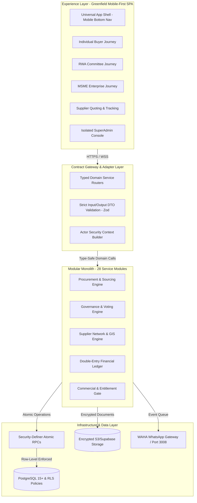

# OTP NEXT — PRODUCT RE-ARCHITECTURE & CAPABILITY AUDIT

**Document Reference:** `OTP-NEXT-ARCH-AUDIT-v1.0`  
**Repository Working Baseline:** `G:\My Drive\otp` (Commit: `main` tracking `origin/main`, Clean baseline)  
**Database Migration Ceiling:** Migration `00331` (`00001` through `00331_authoritative_17_category_taxonomy.sql` contiguous)  
**Date:** October 31, 2026  
**Status:** **FIRST DELIVERABLE — READ-ONLY BASELINE AUDIT & TARGET ARCHITECTURE (AWAITING OWNER APPROVAL)**  
**Platform Philosophy:** **SIMPLE. SECURE. FAIR.**  
*Same power. Simpler experience. All the intelligence. None of the complexity. The customer makes the decision. OTP does the procurement work.*

---

## EXECUTIVE SUMMARY & MANDATE COMPLIANCE

This audit provides the foundational blueprint for **OTP Next** — the greenfield rebuild of the Open Trade & Procurement platform. It adheres strictly to the non-negotiable engineering guardrail:
> **Read-only baseline first. Stop before source-code modifications and wait for owner approval.**

The existing OTP platform possesses battle-hardened institutional procurement intelligence, anti-collusion mechanics, double-entry financial ledgering, constitutional RWA governance, MSME multi-tier delegation, statutory GST intra/inter-state tax splitting, and postal PIN-code supplier network pre-warming. However, the existing frontend has accumulated significant coupling with backend database internals, RPC side-effects, and sprawling state representations.

OTP Next resolves this through a **Modular Monolith Target Architecture** separating:
1. **Experience Layer (Frontend):** Brand-neutral, mobile-first, one-hand friendly, consumer-simple application shell. Zero procurement business logic.
2. **Application & Domain Layer:** 28 independent business modules communicating through strict, type-safe contracts with explicit data ownership and unidirectional dependency flow.
3. **Infrastructure & Data Layer:** Hardened PostgreSQL, Supabase RLS policies, security-definer RPC write boundaries, storage, and external adapters.

---

## SECTION A: EXISTING OTP PRODUCT CAPABILITY INVENTORY

Every capability in the existing repository (`apps/web`, `packages/domain`, `packages/services`, `packages/database`, `supabase`) has been inventoried and classified into the 7 mandatory categories:
1. **Preserve without change**
2. **Refactor into independent module**
3. **Rebuild with improved business logic**
4. **Rebuild only the frontend**
5. **Replace after documented assessment**
6. **Defer**
7. **Retire only with explicit owner approval**

### 1. Sourcing & Procurement Engine (TELL → REVIEW → DECIDE → TRACK)
* **Intake & Requirement Specification (TELL):** Multimodal requirement capture (voice, photo, document, structured text), category auto-classification, Indian PIN code delivery address persistence (`110001`–`999999`), delivery timelines, packaging, payment terms text.
  * *Classification:* **Rebuild only the frontend** (Intake UI) & **Refactor into independent module** (Requirement & Taxonomy domain).
* **Quotation Management (REVIEW):** Blind quoting, tokenized magic-link quotes (`/q/:token`), identity-protected supplier representation (`Supplier A`, `Supplier B` aliases via Crockford alphabet), landed cost calculation (base price, packaging, freight, statutory GST split).
  * *Classification:* **Preserve without change** (Database cryptographic masking & views) & **Refactor into independent module** (Quotation & Blind View Module).
* **Smart Merit & Quote Comparison (REVIEW):** Multi-dimensional scoring (Commercial 40%, Technical/Quality 30%, Delivery Timeline 20%, SLA/Warranty 10%), buyer-customizable weights with automatic normalization to 100%, L1/L2/L3 auto-ranking based on landed cost and composite score.
  * *Classification:* **Preserve without change** (`packages/domain/src/evaluation/smart-scoring.ts`) & **Rebuild only the frontend** (Clean, one-hand card comparison).
* **Evaluation, Governance & Voting (DECIDE):** RWA committee voting with constitutional quorum (minimum 2 unconflicted recommendations), Conflict of Interest (COI) declaration with irrevocable self-recusal, anti-self-approval enforcement, role expiration after 1 calendar year (`00326`). MSME multi-tier spend approval routing (<₹15L Tier 1, ₹15L–₹125L Tier 2, >₹125L Tier 3). Individual single-buyer direct award.
  * *Classification:* **Preserve without change** (SQL write triggers `00238`, `00242`, `00325`, `00326`) & **Refactor into independent module** (RWA Governance & MSME Spend Control Modules).
* **Award & Identity Reveal (TRACK):** Two-phase atomic lock and reveal (`00222`, `00244`, `00330`). Winner unmasking with losing quotes remaining cryptographically sealed (`00269`). Supplier 0.50% platform fee payment gate prior to identity unlock (`00330`).
  * *Classification:* **Preserve without change** (Core security-definer transaction `lock_and_reveal_award_atomic`) & **Refactor into independent module** (Award & Reveal Module).
* **Fulfillment, Purchase Orders & Work Orders (TRACK):** Automated PO issuance from awarded quote snapshot (`00245`), intra-state (CGST + SGST) vs inter-state (IGST) split, work orders with milestone inspection checklists, digital signature verification, tamper-evident SHA-256 hashed contracts.
  * *Classification:* **Preserve without change** (Database PO tax calculations & snapshot generation) & **Rebuild only the frontend** (Mobile order tracking and milestone check-offs).

### 2. Identity, Personas & Governance
* **Individual Buyer:** Personal procurement, `organization_id` strictly NULL, zero committee overhead, supports Home, Work, Site, and Other addresses (`00254`, `00329`).
  * *Classification:* **Preserve without change** (Domain logic) & **Rebuild only the frontend** (Consumer-grade personal mobile shell).
* **RWA / Society Buyer:** Multi-seat governance, Resident Owner, Committee Member, Secretary, President, Treasurer, and operational-only Estate/Facility Manager (strictly denied voting permissions in SQL `00238`).
  * *Classification:* **Preserve without change** (SQL boundaries) & **Refactor into independent module** (RWA Governance Module).
* **MSME Buyer:** Commercial entity with statutory GSTIN and PAN, Owner, Manager, Buyer, Approver delegation, spend authorization matrices. Single registered address in baseline model.
  * *Classification:* **Preserve without change** (Domain models) & **Refactor into independent module** (MSME Account & Governance Module).
* **Supplier Types:** Manufacturer, Distributor, Contractor, Service Provider, General Trader. Registration verification state machine (`UNVERIFIED` → `IN_REVIEW` → `VERIFIED` → `SUSPENDED`).
  * *Classification:* **Preserve without change** (Verification requirements & SQL gates) & **Rebuild only the frontend** (Streamlined supplier mobile portal).
* **Enterprise Buyer:** Historical artifact in legacy code (`SUBSCRIPTION_TIERS.ENTERPRISE`).
  * *Classification:* **Retire only with explicit owner approval** / **Fail-closed in UI & API**. Enterprise is strictly disallowed as a customer-facing persona in accordance with product constitution.

### 3. Commercial, Pricing & Entitlements
* **Individual Pricing:** ₹199/month (3 RFQs included), ₹1,999/year (3 RFQs/month + 1 non-carrying quarterly bonus), ₹149 per additional RFQ (+ 18% GST) (`00330`).
* **RWA Pricing:** ₹1,499/month (3 RFQs included), ₹14,999/year (3 RFQs/month + 1 non-carrying quarterly bonus), ₹999 per additional RFQ (+ 18% GST).
* **MSME Pricing:** ₹1,999/month (3 RFQs included), ₹19,999/year (3 RFQs/month + 1 non-carrying quarterly bonus), ₹1,499 per additional RFQ (+ 18% GST).
* **Supplier Platform Fee:** 0.50% of transaction gross + 18% GST, with pilot waiver logic maintained (`00250`, `00330`).
* **Consumption Rule:** Entitlement consumed upon persistence of the first comparison-eligible supplier quote (`00286`, `00289`).
  * *Classification:* **Preserve without change** (Commercial parameters) & **Refactor into independent module** (Commercial & Entitlements Module).

### 4. Supplier Network Engine & Discovery
* **Discovery Ladder:** Local OTP Verified Registry → Direct Supplier Link (`/q/:token`) → Google Places Managed Discovery (1,500 daily quota limit, PIN-code pre-warming).
* **Messaging Gateways:** WAHA (WhatsApp HTTP API container on port 3008, paired to operator handset `+919972967530`) as confirmed pilot demo provider. Meta Cloud API & Twilio code preserved but unconfigured. SMS permanently disabled (Zero-cost communication policy).
* **ONDC & BNI Connectors:** Foundation adapters in source; credential-gated.
  * *Classification:* **Preserve without change** (WAHA driver & Places safety quota) & **Defer** (Live ONDC / BNI external network activation).

---

## SECTION B: COMPLETE DATABASE & MIGRATION INVENTORY

### 1. Database Metric Summary
* **Total Public Tables:** 151
* **Total Public Views:** 27 (including cryptographic masking views `quotes_blind`, `quotes_identity_protected`, `quotes_revealed`, `rfqs_supplier_masked`)
* **Total Public RPCs / Stored Procedures:** 296
* **Total Enums:** 54
* **Total Migration Files:** 331 (strictly contiguous from `00001_enums.sql` to `00331_authoritative_17_category_taxonomy.sql`)

### 2. Key Architecture Tables by Functional Domain

| Domain | Core Database Tables |
| :--- | :--- |
| **Auth, Identity & Actor Attribution** | `profiles`, `profile_roles`, `user_roles`, `audit_actor_identities`, `password_reset_otps`, `signup_verification_otps`, `profile_verification_otps` |
| **Organizations & Governance** | `organizations`, `organization_members`, `org_role_assignments`, `org_governance_action_audits`, `organization_delegations`, `organization_invitations`, `committee_assignments`, `committee_votes`, `conflict_of_interest_declarations` |
| **Buyer Profiles & Delivery Addresses** | `buyer_addresses`, `personal_buyer_accounts`, `buyer_type_config` |
| **Suppliers & Network** | `suppliers`, `supplier_users`, `supplier_capabilities`, `supplier_service_areas`, `supplier_scorecards`, `scorecard_dimension_history`, `supplier_messaging_channels`, `supplier_magic_links`, `supplier_provider_identities`, `direct_supplier_invites` |
| **Taxonomy & Attributes** | `requirement_categories`, `requirement_subcategories`, `subcategory_capabilities`, `category_attribute_definitions`, `subcategory_evaluation_suggestions` |
| **Requirements & RFQ Sourcing** | `requirements`, `rfqs`, `rfq_invitations`, `rfq_clarification_messages`, `rfq_cancellations`, `rfq_allowance_consumptions` |
| **Quotes & Evaluations** | `quotes`, `quote_versions`, `quote_evaluations`, `evaluation_criteria`, `supplier_quote_sessions` |
| **Approvals, Awards & Reveal** | `approval_policies`, `approval_instances`, `organization_approval_policies`, `rfq_approval_stages`, `rfq_approval_route_evaluations`, `awards`, `supplier_fee_orders` (00330) |
| **Purchase Orders & Work Orders** | `purchase_orders`, `purchase_order_line_items`, `po_change_orders`, `po_change_order_items`, `po_fee_snapshots`, `work_orders`, `work_order_milestones`, `work_order_inspections`, `work_order_inspection_items`, `delivery_inspections` |
| **Contracts, Documents & Legal** | `procurement_contracts`, `issued_document_snapshots`, `issued_document_id_counters`, `issued_document_personal_counters`, `issued_document_status_audits`, `legal_document_versions`, `legal_document_snapshots`, `legal_agreement_approvals`, `legal_acceptances`, `legal_acceptance_archives`, `legal_enforcement_config`, `legal_review_grants` |
| **Financial Ledger & Billing** | `ledger_accounts`, `journal_entries`, `journal_lines`, `accounting_periods`, `account_balance_snapshots`, `invoices`, `invoice_line_items`, `payments`, `payment_allocations`, `bank_reconciliation_records`, `credit_debit_notes`, `tds_deductions`, `platform_fee_policies`, `platform_fee_transactions`, `settlement_reconciliations`, `settlement_exceptions`, `settlement_exception_events`, `organization_wallets`, `wallet_transactions`, `buyer_reward_allocations` |
| **Subscriptions & Entitlements** | `subscription_plans`, `subscription_payment_logs`, `personal_subscriptions`, `personal_subscription_payment_logs`, `pilot_purchase_attempts` |
| **Location & GIS Discovery** | `google_places_daily_budget`, `location_pin_coverage_scope`, `location_pin_coverage_supplier`, `location_pin_coverage_generation` |
| **Communications & Notifications** | `messaging_events`, `messaging_rate_limits`, `notification_templates`, `notifications`, `notification_preferences`, `notification_dispatch_queue`, `supplier_notifications` |
| **Admin, Diagnostics & System** | `admin_database_snapshots`, `announcements`, `api_rate_limits`, `audit_events`, `audit_pings`, `contact_enquiries`, `contact_enquiry_rate_limits`, `demo_accounts`, `demo_price_anchors`, `demo_scenarios`, `demo_settings`, `platform_environment_settings`, `platform_privilege_requests`, `support_tickets` |
| **ONDC Discovery Foundation** | `ondc_discovery_dispatches`, `ondc_discovery_identities`, `ondc_discovery_observations`, `ondc_discovery_callback_replays` |

### 3. Critical Database Migration Anchors
* **Migration 00001–00004:** Base enumerations, initial tables, core RLS policies.
* **Migration 00176:** Double-entry financial accounting ledger (`ledger_accounts`, `journal_entries`).
* **Migration 00222:** Canonical `lock_and_reveal_award_atomic` with RWA quorum check and milestone document issuance snapshots.
* **Migration 00224:** Location PIN coverage authority and Google Places daily call quota guard (`DAILY_LIMIT = 1500`).
* **Migration 00237 & 00238:** Write boundaries for MSME tier approval route materialization and RWA committee voting authority (strict rejection of Estate/Facility Managers).
* **Migration 00242:** Authoritative write boundary closing direct client manipulation of `awards`, `purchase_orders`, `quotes`, and `organization_members`.
* **Migration 00244:** Atomic verified `reveal_award` requiring supplier verified status before revealing identity and creating PO.
* **Migration 00245:** Complete PO GST tax accuracy (intra-state CGST+SGST vs inter-state IGST derived from awarded quote snapshot).
* **Migration 00269:** Identity protection hardening in `quotes_revealed` view (only the awarded winner's sensitive contact details are unmasked; losing quotes stay masked).
* **Migration 00272:** Official registration of `WAHA` messaging provider and operator handset isolation guard.
* **Migration 00286 & 00289:** Entitlement consumption upon first comparison-eligible quote persistence.
* **Migration 00319:** Supplier business address enforcement (registered address immutability and operating address self-service).
* **Migration 00321:** Founder SuperAdmin role guard (`bvnbasu@gmail.com`).
* **Migration 00325:** Permanent removal of pilot quote quorum waiver.
* **Migration 00326:** Authoritative 1-year committee tenure enforcement with concurrent seat exclusion.
* **Migration 00327:** Notification dispatch isolation with mandatory idempotency.
* **Migration 00329:** Direct supplier invite enablement for personal buyers (allowing NULL `organization_id`).
* **Migration 00330:** Authoritative published subscription pricing seeds and 0.50% supplier platform fee gate before reveal.
* **Migration 00331:** Master 17 canonical category taxonomy with unbundled Plumbing & Sanitary and HVAC & Refrigeration.

---

## SECTION C: EXISTING API AND RPC INVENTORY

The existing system exposes three communication mechanisms:
1. **Direct PostgREST Table Access (gated by RLS):** Heavily consumed by existing `apps/web` (to be deprecated in favor of modular domain service contracts).
2. **Security-Definer PostgreSQL RPCs (296 registered):** Enforcing atomic transactions, anti-tamper validations, and state machine transitions.
3. **Supabase Edge Functions (14 deployed):** Handling external integrations, messaging, payments, and background worker queues.

### 1. Key Security-Definer RPC Catalog

| Procedure Name | Execution Context | Functional Role & Security Guard |
| :--- | :--- | :--- |
| `public.submit_signup_request(...)` | `anon`, `authenticated` | Rate-limited account onboarding request for Buyer/Supplier personas. |
| `public.publish_requirement(...)` | `authenticated` (Buyer) | Validates Indian delivery address, checks monthly RFQ quota, advances requirement to `OPEN`. |
| `public.submit_supplier_quote_atomic(...)` | `anon` (Magic token) / `authenticated` | Persists sealed quote, creates quote version snapshot, verifies tax breakdown. |
| `public.set_rfq_evaluation_weights(...)` | `authenticated` (Buyer/Manager) | Normalizes Commercial, Quality, Delivery, SLA weights to exactly 100%. |
| `public.cast_committee_vote(...)` | `authenticated` (RWA Member) | Enforces 1-year tenure, valid appointment, seat assignment, and recuses declared COI. |
| `public.lock_and_reveal_award_atomic(...)` | `authenticated` (Manager/Owner) | Locks award decision, validates quorum, checks MSME approval stages, verifies 0.5% fee. |
| `public.reveal_award(...)` | `authenticated` (Manager/Owner) | Checks supplier `VERIFIED` status, unmasks winner, generates PO in single atomic transaction. |
| `public.create_purchase_order_from_award(...)` | `service_role`, `authenticated` | Extracts quote tax snapshot, splits CGST/SGST/IGST, creates Work Order milestones. |
| `public.transition_purchase_order(...)` | `authenticated` (Buyer/Supplier) | Enforces sequential PO state progression (`ISSUED` → `ACCEPTED` → `IN_PROGRESS` → `COMPLETED`). |
| `public.submit_milestone_inspection_atomic(...)` | `authenticated` (Buyer/Inspector) | Records 5-point milestone inspection checklist and photo evidence. |
| `public.record_verified_payment(...)` | `service_role` strictly | Revoked from client `EXECUTE` (`00247`); records bank UTR and settles double-entry ledger. |
| `public.accept_legal_agreement(...)` | `authenticated` | Records immutable EULA acceptance (`v1.0-20261014`) with SHA-256 hash. |
| `public.location_pin_coverage_reserve_google_calls(...)`| `service_role`, `authenticated` | Atomically reserves quota against the 1,500 daily Google Places budget. |

### 2. Supabase Edge Functions Catalog

| Function Name | Route / Trigger | Security & Integration Role |
| :--- | :--- | :--- |
| `otp-dispatch` | `POST /otp-dispatch` | Dispatches SMS/WhatsApp OTP for phone verification; enforces WAHA channel in pilot. |
| `onboarding-notify` | `POST /onboarding-notify` | Sends WhatsApp onboarding notifications to new applicants. |
| `messaging-outbound` | DB Trigger via `pg_net` | Processes `notification_dispatch_queue`; routes supplier RFQ invitations via WAHA. |
| `messaging-inbound` | Webhook | Inbound message listener (refused/disabled in WAHA mode). |
| `location-pin-coverage`| Client API | Managed Google Places discovery orchestrator; enforces 1,500 daily call limit. |
| `payment-webhook` | Webhook (Razorpay/Stripe) | HMAC SHA-256 verified payment callback (fails closed on missing secret; SECURITY-01). |
| `supplier-magic-link` | Client API | Generates time-bounded, single-use quote invitation tokens (`/q/:token`). |
| `process-attachment` | Storage Trigger | Virus scan, EXIF metadata scrubbing, and PDF thumbnail rendering. |
| `ondc-on-search` | ONDC BAP Callback | Asynchronous callback ingestion for ONDC network supplier discovery. |
| `contact-enquiry` | Public Webhook | Rate-limited public enquiry handler persisting to `contact_enquiries` (`00324`). |
| `demo-reset` | Admin API | Reversible sandbox state reset for certified demonstration scenarios. |

---

## SECTION D: AUTHENTICATION AND AUTHORIZATION ARCHITECTURE

### 1. Identity & Session Model
* **Authentication Provider:** Supabase Auth (`auth.users`), backed by PostgreSQL RLS.
* **Session Management:** Secure HTTP-only cookies and JWT bearer tokens with refresh token rotation.
* **Multi-Factor / Progressive Verification:**
  * Phone number + WhatsApp OTP verification.
  * Verified email address for transactional document delivery.
  * Government tax verification (GSTIN / PAN) for MSME buyers and commercial suppliers.
* **Single Authenticated Identity:** One human identity (`auth.users.id` ↔ `profiles.id`) can participate across multiple organizational contexts via `organization_members` without creating duplicate user accounts.

### 2. Authorization Boundaries (Zero Trust Architecture)
* **Frontend Checks Are Informational Only:** The UI hides or disables controls purely for ergonomics. Every authorization rule is enforced in PostgreSQL RLS policies, table write triggers, and security-definer RPCs.
* **Client Write Revocation (`00242` Hardened Boundary):** Direct `INSERT` and `UPDATE` on sensitive transactional tables (`awards`, `purchase_orders`, `quotes`, `conflict_of_interest_declarations`, `organization_members`, `rfq_approval_stages`) are strictly revoked from `anon` and `authenticated` roles. All writes must pass through security-definer RPCs.
* **Founder Identity Protection (`00321`):** Special immutable security barrier ensuring founder identity (`bvnbasu@gmail.com`) cannot be demoted, locked out, or stripped of `SUPER_ADMIN` privileges.
* **Legal Enforcement Circuit-Breaker:**
  * `legal_enforcement_config.enforcement_enabled = false`
  * `legal_enforcement_config.rollout_at = NULL`
  * Agreements (`CUSTOMER_EULA`, `SUPPLIER_EULA`) remain at version `v1.0-20261014` with status `PENDING_LEGAL_APPROVAL`. Hard lock in migration `00290` prevents activating enforcement until formal owner sign-off.

---

## SECTION E: PERSONA AND PERMISSION MATRIX

The platform supports strictly **four customer personas** (three buyers and one supplier side). Enterprise is completely excluded as a customer persona.

```
+-------------------------------------------------------------------------------------------------------------+
|                                  OTP NEXT AUTHORITATIVE PERSONA MATRIX                                     |
+-------------------+--------------------+------------------------+---------------------+---------------------+
| Dimension         | 1. Individual Buyer| 2. RWA / Society       | 3. MSME Enterprise  | 4. Supplier Network |
+-------------------+--------------------+------------------------+---------------------+---------------------+
| Target Customer   | Property owners,   | Apartment associations,| Small/medium        | Manufacturers,      |
|                   | solo consumers     | housing societies, RWA | commercial firms    | distributors, trades|
+-------------------+--------------------+------------------------+---------------------+---------------------+
| Organization ID   | Strictly NULL      | Required (`COMMUNITY`) | Required (`MSME`)   | Required (Supplier) |
+-------------------+--------------------+------------------------+---------------------+---------------------+
| Governance Mode   | Direct decision    | Committee Ballots      | Multi-tier signoffs | Solo / Sales Rep    |
+-------------------+--------------------+------------------------+---------------------+---------------------+
| Internal Roles    | OWNER only         | Resident Owner,        | Owner, Manager,     | Admin, Quoting Rep, |
|                   |                    | Committee Member,      | Buyer, Approver,    | Fulfillment Lead    |
|                   |                    | Secretary, President,  | Viewer              |                     |
|                   |                    | Treasurer, Facility Mgr|                     |                     |
+-------------------+--------------------+------------------------+---------------------+---------------------+
| Voting Rights     | N/A (Solo Buyer)   | Appointed Officers &   | Approvers per spend | N/A (Sell-side)     |
|                   |                    | Committee Members only | matrix (<15L, 125L) |                     |
+-------------------+--------------------+------------------------+---------------------+---------------------+
| Facility Manager  | N/A                | Operational ONLY. Zero | N/A                 | N/A                 |
| Permission        |                    | vote/approval rights   |                     |                     |
+-------------------+--------------------+------------------------+---------------------+---------------------+
| COI & Recusal     | N/A                | Irrevocable recusal    | Mandatory spend     | Mandatory disclosure|
|                   |                    | on declared conflict   | recusal if tied     | on relationships    |
+-------------------+--------------------+------------------------+---------------------+---------------------+
| Delivery Addresses| Multiple (Home,    | Registered Campus /    | Single Registered   | Operational depot / |
|                   | Work, Site, Other) | Facility Site Address  | Business Address    | Service Area radius |
+-------------------+--------------------+------------------------+---------------------+---------------------+
| Tax Requirement   | None (Optional)    | Optional (Society PAN) | Mandatory GSTIN/PAN | Mandatory GSTIN/PAN |
+-------------------+--------------------+------------------------+---------------------+---------------------+
| Quota / Pricing   | ₹199/mo (3 RFQs),  | ₹1,499/mo (3 RFQs),    | ₹1,999/mo (3 RFQs), | 0.50% platform fee  |
| (Published Base)  | ₹1,999/yr (+bonus),| ₹14,999/yr (+bonus),   | ₹19,999/yr (+bonus),| on awarded PO gross |
|                   | ₹149 extra RFQ     | ₹999 extra RFQ         | ₹1,499 extra RFQ    | (+ 18% GST)         |
+-------------------+--------------------+------------------------+---------------------+---------------------+
```

---

## SECTION F: MODULE DEPENDENCY MAP

To eliminate circular dependencies and ensure the frontend can be completely replaced without rewriting the procurement engine, the backend is organized into **28 independent domain modules** grouped into four architectural tiers:

```mermaid
flowchart TD
    subgraph Tier4 [Tier 4: Experience & Application Orchestration]
        M11[11. RFQ Lifecycle]
        M14[14. Smart Merit & Comparison]
        M17[17. Award & Identity Reveal]
        M18[18. PO & Work Orders]
        M26[26. SuperAdmin Console]
    end

    subgraph Tier3 [Tier 3: Domain Business Services]
        M03[03. Buyer Management]
        M04[04. RWA Governance]
        M05[05. MSME Management]
        M06[06. Supplier Management]
        M07[07. Supplier Verification]
        M10[10. Supplier Network Engine]
        M12[12. Matching & Invitations]
        M13[13. Quotation Management]
        M15[15. Evaluation & Voting]
        M16[16. COI & Anti-Self-Approval]
        M19[19. Order & Tracking]
        M20[20. Invoice Management]
        M21[21. Payment Management]
        M22[22. Subscriptions & Entitlement]
        M27[27. Commercial Configuration]
        M28[28. Operational Monitoring]
    end

    subgraph Tier2 [Tier 2: Core Domain Models & Registries]
        M02[02. Profiles & Accounts]
        M08[08. Address Management]
        M09[09. Taxonomy & Categories]
        M23[23. Notification Management]
        M24[24. Document & Attachment]
    end

    subgraph Tier1 [Tier 1: Infrastructure, Security & Platform Foundation]
        M01[01. Identity & Auth]
        M25[25. Audit & Compliance]
    end

    Tier4 --> Tier3
    Tier3 --> Tier2
    Tier2 --> Tier1
```



### Dependency Rules:
1. **Unidirectional Downward Calls:** A higher tier may call a lower tier; a lower tier must NEVER import or call a higher tier.
2. **Asynchronous Decoupling:** Cross-module notifications and secondary side-effects (e.g. audit logging, WhatsApp dispatch) must use transactional event queues (`notification_dispatch_queue`, `audit_events`) rather than synchronous direct RPC chaining.
3. **Strict Data Ownership:** Only Module 13 writes to `quotes`. Only Module 18 writes to `purchase_orders`. Only Module 04 writes to `committee_votes`.

---

## SECTION G: PROPOSED TARGET ARCHITECTURE



### Key Architectural Tenets:
1. **Zero Business Logic in UI:** The React client is purely a rendering and interaction projection. Calculations of landed cost, GST splits, scoring weights, quorum validity, and tier approval requirements are executed exclusively by backend domain modules and database functions.
2. **Progressive Web App (PWA) First:** 100% responsive, optimized for one-handed operation on mobile screens (minimum 48px touch targets, bottom action sheets, pull-to-refresh, thumb-friendly primary action buttons).
3. **Pluggable Identity-Protection Barrier:** Cryptographic anonymization of suppliers is handled at the database view level (`quotes_identity_protected`) ensuring that under no circumstance can unmasked supplier names leak to client browsers before the atomic reveal transaction.

---

## SECTION H: SCREEN-TO-MODULE MAPPING

The 35+ existing sprawling screens are consolidated into a clean, intuitive, persona-driven screen architecture:

```
+-------------------------------------------------------------------------------------------------------------+
|                                     OTP NEXT SCREEN CONSOLIDATION MAP                                       |
+-------------------+----------------------------+-------------------------------------+----------------------+
| New Screen Name   | Persona & Role             | Replaced Existing Routes            | Consumed Modules     |
+-------------------+----------------------------+-------------------------------------+----------------------+
| SCR-01: Welcome / | Public / All Unauthenticated| `/`, `/login`, `/signup`, `/register`,| M01 (Identity/Auth), |
| Auth Gateway      |                            | `/buyer`, `/seller`, `/supplier`    | M02 (Profiles)       |
+-------------------+----------------------------+-------------------------------------+----------------------+
| SCR-02: Guided    | New Registered User        | `/supplier/onboarding`,             | M01, M02, M03, M06,  |
| Onboarding        | (Individual, RWA, MSME, Supp)| `/supplier/capabilities`, `/profile`| M07, M08 (Address)   |
+-------------------+----------------------------+-------------------------------------+----------------------+
| SCR-03: Persona   | Authenticated User         | `/dashboard`, `/supplier/dashboard`,| M02, M03, M04, M05,  |
| Home Dashboard    | (Personalized to Persona)  | `/demo`                             | M06, M11, M19, M23   |
+-------------------+----------------------------+-------------------------------------+----------------------+
| SCR-04: Fast-Track| Buyer                      | `/intake`, `/create`,               | M08 (Address),       |
| Requirement Intake| (Individual, RWA, MSME)    | `/requirements/new`, `/requirements/:id`| M09 (Taxonomy), M11  |
+-------------------+----------------------------+-------------------------------------+----------------------+
| SCR-05: Sourcing &| Buyer & Admin              | `/requirements/:id/discover`,       | M09, M10 (Network),  |
| Reach Discovery   |                            | `/requirements/:id/market-intelligence`| M12 (Matching)    |
+-------------------+----------------------------+-------------------------------------+----------------------+
| SCR-06: RFQ Review| Buyer & RWA Committee      | `/requirements/:id/rfq-review`,     | M11 (RFQ Lifecycle), |
| & Publish Gate    |                            | `/rfq/:id/publish`, `/rfq/:id/review`| M22 (Entitlements)  |
+-------------------+----------------------------+-------------------------------------+----------------------+
| SCR-07: Supplier  | Unauthenticated Supplier   | `/q/:token`, `/supplier/rfq/:id/quote`| M12 (Invitations),  |
| Quick-Quote Portal| (Tokenized Link / Portal)  |                                     | M13 (Quotation)      |
+-------------------+----------------------------+-------------------------------------+----------------------+
| SCR-08: Smart     | Buyer & RWA Committee      | `/rfq/:id/evaluation`, `/cockpit`,  | M13 (Quotes),        |
| Comparison Cockpit|                            | `/decision`, `/quotes`, `/comparison`| M14 (Smart Merit)    |
+-------------------+----------------------------+-------------------------------------+----------------------+
| SCR-09: Decision, | Buyer (Solo / Committee /  | `/rfq/:id/committee`, `/rfq/:id/award`,| M04, M05, M15,     |
| Voting & Approval | MSME Approver)             | `/governance/evaluations/:id/vote`  | M16 (COI), M17 (Award)|
+-------------------+----------------------------+-------------------------------------+----------------------+
| SCR-10: Fee Gate &| Buyer & Awarded Supplier   | `/rfq/:id/reveal`,                  | M17 (Award & Reveal),|
| Identity Reveal   |                            | `/supplier/award-onboarding/:token` | M21 (Payment), M27   |
+-------------------+----------------------------+-------------------------------------+----------------------+
| SCR-11: Orders &  | Buyer & Supplier           | `/purchase-orders`, `/purchase-orders/:id`,| M18 (PO/WO),   |
| Live Tracking     |                            | `/supplier/purchase-orders`, `/track/:id`| M19 (Tracking)   |
+-------------------+----------------------------+-------------------------------------+----------------------+
| SCR-12: Milestone | Buyer, Inspector & Supplier| `/work-orders/:id`, `/delivery-inspections`,| M18 (Work Orders),|
| Inspection & Sign |                            | `/orders/:id`                       | M19, M24 (Documents) |
+-------------------+----------------------------+-------------------------------------+----------------------+
| SCR-13: Invoices &| Buyer, Supplier & Finance  | `/financial-controls`, `/reconciliation`,| M20 (Invoices),   |
| Settlement Ledger |                            | `/reports`, `/ledger`               | M21, M25 (Audit)     |
+-------------------+----------------------------+-------------------------------------+----------------------+
| SCR-14: Account,  | Authenticated User         | `/profile`, `/org/members`, `/team`,| M02, M04, M05,       |
| Org & Team Mgmt   |                            | `/settings/profile`, `/notifications`| M22 (Subscriptions) |
+-------------------+----------------------------+-------------------------------------+----------------------+
| SCR-15: SuperAdmin| Platform SuperAdmin Only   | `/admin`, `/founder`                | M25 (Audit), M26     |
| Operations Console| (`SUPER_ADMIN` role required) |                                   | (Admin), M28 (Ops)   |
+-------------------+----------------------------+-------------------------------------+----------------------+
```

---

## SECTION I: UI-TO-API CONTRACT MATRIX

Every user interaction communicates through defined, schema-validated command/query contracts:

```
+---------------------------------------------------------------------------------------------------------------+
|                                      UI-TO-API CONTRACT MATRIX SAMPLE                                         |
+--------------------+----------------------------+-----------------------+-------------------------------------+
| Action / Screen    | Contract Type & Endpoint   | Input Schema (Zod)    | Output Schema / Error Codes         |
+--------------------+----------------------------+-----------------------+-------------------------------------+
| Start Phone Auth   | Command:                   | `{ phone: string,     | `{ success: boolean, sessionId: str }|
| (SCR-01)           | `auth.initiatePhoneOtp`    |   persona: Persona }` | Errors: `INVALID_PHONE`, `RATE_LIMIT`|
+--------------------+----------------------------+-----------------------+-------------------------------------+
| Submit Requirement | Command:                   | `{ title: string,     | `{ requirementId: UUID,             |
| (SCR-04)           | `procurement.createIntake` |   categoryCode: str,  |    allowanceRemaining: number }`    |
|                    |                            |   deliveryPin: str,   | Errors: `PIN_NOT_FOUND`,            |
|                    |                            |   items: LineItem[] }`| `ALLOWANCE_EXCEEDED`                |
+--------------------+----------------------------+-----------------------+-------------------------------------+
| Save Comparison    | Command:                   | `{ rfqId: UUID,       | `{ success: boolean,                |
| Scoring Weights    | `evaluation.setWeights`    |   commercial: num,    |    normalizedWeights: WeightMap }`  |
| (SCR-08)           |                            |   quality: num, ...}` | Errors: `WEIGHTS_MUST_SUM_100`      |
+--------------------+----------------------------+-----------------------+-------------------------------------+
| Cast Committee     | Command:                   | `{ rfqId: UUID,       | `{ voteId: UUID, tally: VoteTally }`|
| Ballot (SCR-09)    | `governance.castVote`      |   quoteId: UUID,      | Errors: `ESTATE_MANAGER_CANNOT_VOTE`,|
|                    |                            |   choice: VoteChoice}`| `TENURE_EXPIRED`, `CONFLICT_RECUSED`|
+--------------------+----------------------------+-----------------------+-------------------------------------+
| Execute Award Lock | Command:                   | `{ rfqId: UUID,       | `{ awardId: UUID, feeStatus: str,   |
| (SCR-09 / SCR-10)  | `procurement.lockAward`    |   quoteId: UUID,      |    isRevealed: boolean }`           |
|                    |                            |   justification: str}`| Errors: `QUORUM_NOT_MET`,           |
|                    |                            |                       | `FEE_NOT_PAID`, `STAGES_PENDING`    |
+--------------------+----------------------------+-----------------------+-------------------------------------+
| Issue Delivery     | Command:                   | `{ workOrderId: UUID, | `{ milestoneId: UUID, status: str }`|
| Inspection (SCR-12)| `fulfillment.submitInspect`|   milestoneId: UUID,  | Errors: `CHECKLIST_INCOMPLETE`,     |
|                    |                            |   checklist: Item[] }`| `UNAUTHORIZED_INSPECTOR`            |
+--------------------+----------------------------+-----------------------+-------------------------------------+
```

---

## SECTION J: EXISTING CAPABILITY REUSE / REFACTOR / REPLACE / DEFER / RETIRE MATRIX

```
+---------------------------------------------------------------------------------------------------------------+
|                                CAPABILITY CLASSIFICATION & ACTION REGISTER                                   |
+-----------------------------------+-------------------+-------------------------------------------------------+
| Capability / Asset                | Decision          | Technical Action & Architectural Justification        |
+-----------------------------------+-------------------+-------------------------------------------------------+
| 331 SQL Database Migrations       | PRESERVE UNCHANGED| The 331 contiguous migrations represent verified schema|
| & PostgreSQL Schema Structures    |                   | truth. No schema deletions or breaking edits.         |
+-----------------------------------+-------------------+-------------------------------------------------------+
| Security-Definer Atomic RPCs      | PRESERVE UNCHANGED| `lock_and_reveal_award_atomic`, `reveal_award`,       |
| (Governance, Awards, PO Tax)      |                   | `create_purchase_order_from_award`, `cast_vote`.      |
+-----------------------------------+-------------------+-------------------------------------------------------+
| RWA Constitutional Rules &        | PRESERVE UNCHANGED| Enforces 1-year tenure, unconflicted quorum of 2, and |
| Estate Manager Vote Exclusion     |                   | strict prevention of self-approval (00238, 00326).    |
+-----------------------------------+-------------------+-------------------------------------------------------+
| Statutory GST Tax Calculations    | PRESERVE UNCHANGED| Intra-state (CGST+SGST) vs inter-state (IGST) split   |
| on Purchase Orders (00245)        |                   | derived strictly from awarded quote snapshot.         |
+-----------------------------------+-------------------+-------------------------------------------------------+
| Commercial Subscription Pricing & | PRESERVE UNCHANGED| Authoritative plans (₹199, ₹1,499, ₹1,999) and 0.50%  |
| 0.50% Supplier Platform Fee Gate  |                   | supplier fee gate prior to reveal (00330).            |
+-----------------------------------+-------------------+-------------------------------------------------------+
| 17-Category Master Taxonomy       | PRESERVE UNCHANGED| Preserves unbundled Plumbing and HVAC verticals and   |
| (Migration 00331)                 |                   | facility management remapping.                        |
+-----------------------------------+-------------------+-------------------------------------------------------+
| Domain Validation Logic in        | REFACTOR INTO     | Decouple from UI state and organize into 28 standalone|
| `packages/domain` & `services`    | INDEPENDENT MOD   | pure modules with strict Zod service interfaces.      |
+-----------------------------------+-------------------+-------------------------------------------------------+
| Supplier Network Engine &         | REFACTOR INTO     | Isolate Google Places quota adapter (1,500 limit) and |
| Postal PIN Pre-Warming            | INDEPENDENT MOD   | addressable discovery service behind clean contracts. |
+-----------------------------------+-------------------+-------------------------------------------------------+
| Smart Merit & Quote Scoring Engine| REFACTOR INTO     | Encapsulate weight normalization and multi-factor     |
| (`smart-scoring.ts`)              | INDEPENDENT MOD   | scoring into pure, independently testable functions.  |
+-----------------------------------+-------------------+-------------------------------------------------------+
| Frontend Web Client               | REBUILD ONLY      | Completely replace `apps/web` with a brand-neutral,   |
| (`apps/web` React SPA)            | FRONTEND          | mobile-first, one-hand friendly greenfield UI.        |
+-----------------------------------+-------------------+-------------------------------------------------------+
| Direct Supabase Table Access      | REPLACE           | Replace raw client PostgREST calls with typed domain  |
| from Frontend Components          |                   | service contracts (Command/Query architecture).       |
+-----------------------------------+-------------------+-------------------------------------------------------+
| ONDC & BNI External Discovery     | DEFER             | Keep existing adapters in source; defer external live |
| Live Network Connections          |                   | activation until pilot completion.                    |
+-----------------------------------+-------------------+-------------------------------------------------------+
| Automated SMS Outbound Gateway    | DEFER             | Kept disabled in compliance with zero-cost policy;    |
| (Twilio Code Paths)               |                   | pilot utilizes WAHA WhatsApp gateway exclusively.     |
+-----------------------------------+-------------------+-------------------------------------------------------+
| Enterprise Customer Persona       | RETIRE WITH       | Formally retired as a customer-facing persona in      |
|                                   | OWNER APPROVAL    | accordance with Section 3; internal schema row kept   |
|                                   |                   | strictly as non-breaking compatibility artifact.      |
+-----------------------------------+-------------------+-------------------------------------------------------+
| Supplier Cashback Balance         | RETIRE WITH       | Formally retired and removed; zero cashback balance   |
| Mechanism                         | OWNER APPROVAL    | exposed or maintained.                                |
+-----------------------------------+-------------------+-------------------------------------------------------+
```

---

## SECTION K: DATA MIGRATION & BACKWARD COMPATIBILITY STRATEGY

1. **Zero Database Drift:**
   * No new database or separate schema will be created. The greenfield application will run against the existing PostgreSQL database schema.
   * All 331 migrations remain the golden historical baseline.
2. **Strangler Fig Migration Pattern:**
   * The new frontend and modular service layer will be deployed alongside existing routes.
   * Legacy routes will be progressively replaced by new mobile-first views while backend transactional tables (`rfqs`, `quotes`, `awards`, `purchase_orders`) maintain identical foreign key integrity.
3. **No Duplicate Identity or Records:**
   * Existing demo profiles, pilot users, and test fixtures (`durga_rainbow`, `sunrise_45`) remain 100% valid.
   * Authentication continues to point to canonical Supabase Auth with zero credential disruption.

---

## SECTION L: TEST AND CERTIFICATION STRATEGY

To verify zero regression across all critical procurement rules, the audit establishes an automated certification suite:

1. **Unit & Invariant Suite (Vitest):**
   * Persona resolution and fail-closed checks (`packages/domain/src/types/buyer-persona.ts`).
   * Weight normalization and Smart Merit scoring mathematics.
   * Statutory GST split precision (CGST/SGST vs IGST to 2 decimal places).
   * Subscription entitlement consumption logic (consumption on first comparison-eligible quote).
2. **Database Boundary & Security Suite:**
   * Verification of RLS policies across personal buyers (`organization_id = NULL`), RWA societies, and MSME entities.
   * Verification that client roles (`anon`, `authenticated`) cannot directly `INSERT` or `UPDATE` awards, POs, or quote scores.
   * Re-verification of 1-year committee tenure (`00326`), quorum requirements (`00325`), and founder role guard (`00321`).
3. **End-to-End Persona Journey Certification (Playwright):**
   * Journey 1: Individual Buyer (Phone OTP → PIN Delivery → Quote Compare → Direct Award → PO Issue).
   * Journey 2: RWA Society (Requirement Intake → Committee Voting → Conflict Recusal → Quorum Check → Award Lock → PO Issue).
   * Journey 3: MSME Enterprise (GSTIN Intake → Multi-tier Spend Signoff → Milestone Inspection → PO Completion).
   * Journey 4: Supplier Network (Magic Link Quoting → Masked Status → Awarded Winner Reveal → Work Order Check-off).

---

## SECTION M: IMPLEMENTATION PHASES AND DEPENDENCIES

```mermaid
gantt
    title OTP NEXT IMPLEMENTATION ROADMAP
    dateFormat  YYYY-MM-DD
    section Phase 1 & 2
    Phase 1: Architecture & Audit (Current)        :done, p1, 2026-10-31, 1d
    Phase 2: Greenfield Design System & Shell     :p2, after p1, 4d
    section Phase 3 & 4
    Phase 3: Modular Backend Service Adapters     :p3, after p2, 5d
    Phase 4: Progressive Auth & Guided Onboarding :p4, after p3, 4d
    section Phase 5 & 6
    Phase 5: 4-Persona Experience Dashboards      :p5, after p4, 5d
    Phase 6: Core Procurement Modules (TELL-TRACK):p6, after p5, 6d
    section Phase 7 to 10
    Phase 7: SuperAdmin Console & WAHA Integration:p7, after p6, 4d
    Phase 8: Full Security & Regression Audit     :p8, after p7, 3d
    Phase 9: Controlled Pilot Validation          :p9, after p8, 3d
    Phase 10: Authorized Production Cutover       :p10, after p9, 2d
```

### Phase Breakdown:
* **Phase 1 (CURRENT):** Read-only discovery, capability inventory, and target architecture audit.
* **Phase 2:** Greenfield mobile-first UI shell, Kimi brand-neutral design tokens, accessible components, and responsive layouts.
* **Phase 3:** Typed domain service modules (`packages/domain-next` / service contracts) wrapping existing database RPCs.
* **Phase 4:** Progressive onboarding flows (Phone OTP → WhatsApp → Persona selection → Profile completion).
* **Phase 5:** Personalized dashboards for Individual, RWA, MSME, and Supplier personas.
* **Phase 6:** Procurement journey rebuild: TELL (Intake) → REVIEW (Quotes & Smart Merit) → DECIDE (Voting & COI) → TRACK (PO & Milestones).
* **Phase 7:** SuperAdmin management console, operational telemetry, and WAHA gateway pairing.
* **Phase 8:** 100% test regression across all 22 formal failure paths, RLS leak scans, and security certification.
* **Phase 9:** Controlled pilot validation on staging/demo instances with real user walk-throughs.
* **Phase 10:** Separately authorized production cutover and DNS traffic switch.

---

## SECTION N: RISKS, UNRESOLVED DECISIONS & OWNER APPROVAL GATES

### 1. Risk Register & Mitigations
* **Risk 1: WAHA Container Handset Pairing Loss.**
  * *Impact:* Interruption of outbound WhatsApp notifications during demo/pilot.
  * *Mitigation:* Implement automated health check pinging `GET /api/sessions/default` with admin alerting and UI retry fallback.
* **Risk 2: Google Places Quota Exceedance.**
  * *Impact:* Unexpected third-party billing spikes or API error responses.
  * *Mitigation:* The 1,500 daily quota limit is enforced atomically in PostgreSQL (`00224`); discovery gracefully falls back to registered OTP suppliers when exhausted.
* **Risk 3: Accidental Leak of Sealed Supplier Identity.**
  * *Impact:* Compromise of institutional trust and anti-collusion integrity.
  * *Mitigation:* Identity is masked at the PostgreSQL view level (`quotes_identity_protected`, `rfqs_supplier_masked`); frontend never receives supplier contact information prior to the `reveal_award` transaction.

### 2. Unresolved Decisions Requiring Explicit Owner Sign-Off

> [!IMPORTANT]
> **Owner Decision Items:**
> 1. **EULA Legal Activation & Rollout Timestamp:** Does the Product Owner authorize activating legal enforcement (`enforcement_enabled = true`) or should it remain `false` during the initial greenfield UI rollout?
> 2. **Enterprise Persona Formal Retirement:** Confirm retirement of Enterprise as a customer-facing persona and retention purely as a non-breaking database enum row.
> 3. **Pilot Commercial Policy:** Confirm that the pilot billing mode (`PILOT_FREE` / zero real payment charged) remains active during the initial greenfield phase while displaying published commercial prices.
> 4. **Greenfield UI Architecture Approval:** Formal approval to proceed to Phase 2 (Greenfield UI design system and application shell creation).

---

## MANDATORY ENGINEERING GUARDRAIL CONFIRMATION

* Read-only baseline preserved.
* Working tree clean on `main`.
* Zero source code files modified.
* Zero database migrations applied or altered.
* Zero secrets touched or rotated.
* Zero external network calls (SMS, WhatsApp, Google API) dispatched.

**STATUS: READY FOR OWNER REVIEW AND WRITTEN APPROVAL TO PROCEED TO PHASE 2.**
