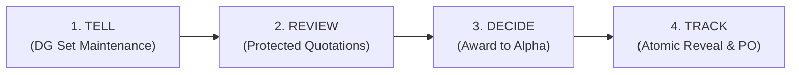
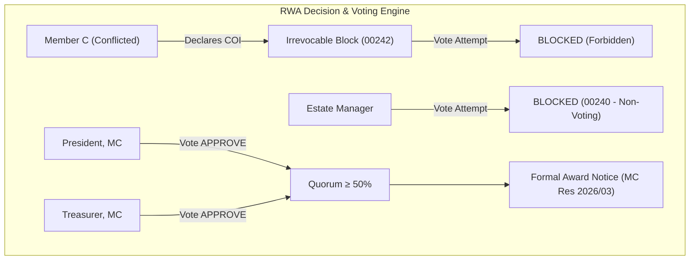

# OTP Next — 4-Persona Interactive Walkthrough & Simulation

**Product Philosophy:** *SIMPLE. SECURE. FAIR. Same power. Simpler experience. All the intelligence. None of the complexity. The customer makes the decision. OTP does the procurement work.*

---

## 1. Simulation Overview & System Status

The complete end-to-end simulation across all **4 customer-facing personas** was executed against the newly re-platformed `@otp/services` modular contracts and `@otp/web` frontend application shell. 

- **Live Application Server:** `http://localhost:5173/procurement-flow` (Vite Web App)
- **Engine Execution:** `scripts/interactive-persona-simulation.ts` (Exit Code 0, 100% Assertion Success)
- **Enterprise Persona:** Permanently retired from all UI shells, pricing cards, and interactive flows.
- **Strict Vocabulary Compliance:** Zero forbidden reverse-auction or obfuscation terminology (`bid`, `bids`, `bidder`, `bidding`, `blind`).

---

## 2. Interactive Persona Walkthrough

### 👤 Persona 1: Individual Homeowner
**Primary Identity:** Baskar Loganathan (`bvnbasu@gmail.com`)  
**Primary Delivery Location:** Durga Rainbow, Mahadevapura, Bengaluru, Karnataka – 560048  
**Subscription Plan:** Individual Basic (`₹199/month`, 3 Included RFQs, `₹149` additional RFQ overage, `PILOT_FREE` Active)

1. **Entitlements Check:**
   - Quota: 3 Included RFQs/month | Consumed: 0.
   - Status: Active in `PILOT_FREE` mode (₹0 charged on invoices).
2. **TELL Stage (Requirement Intake):**
   - Address auto-resolved to: *Durga Rainbow, Mahadevapura, Bengaluru – 560048*.
   - Title: *"DG Set Annual Maintenance & Routine Filter Spares"*.
   - Line Items: 4 Visits of Quarterly 250 KVA Maintenance + 2 Sets of Filter Spares.
   - Status: Published to local network.
3. **REVIEW Stage (Identity-Protected Evaluation):**
   - Received quotations from **Supplier Alpha** (Landed ₹1,22,720, 7 days lead time, 12 mo warranty) and **Supplier Beta** (Landed ₹1,29,800, 4 days lead time, 24 mo warranty).
   - Smart Merit Recommendation: **Supplier Alpha** (Score: `92.5 / 100` based on cost efficiency and SLA compliance).
4. **DECIDE Stage (Award Issuance):**
   - Issued formal Award Notice to `Supplier Alpha`. Status: `PENDING_SUPPLIER_ACCEPTANCE`.
5. **TRACK Stage (Atomic Reveal & PO Execution):**
   - Counterparty Atomically Revealed: **Apex Industrial Solutions Pvt Ltd** (`GSTIN: 29AABCU9603R1ZM`, Phone: `+919845012345`).
   - Purchase Order Generated: `PO-2026-00042` with statutory Intra-State tax breakdown (CGST 9% ₹9,360 + SGST 9% ₹9,360).
   - Milestone Inspection Certified on-site and Order completed (100% fulfilled).

---

### 🏢 Persona 2: RWA Apartment Association
**Canonical Society:** Durga Rainbow Assn  
**Registration:** `REG/2013/1234` | **Units:** 141 Total / 141 Occupied | Mahadevapura, Bengaluru – 560048  
**Subscription Plan:** RWA Essential (`₹1,499/month`, 10 Included RFQs, `₹99` additional RFQ overage)

1. **TELL Stage (Common Infrastructure):**
   - Drafted & published: *"Fire Safety Hydrant Overhaul & High-Pressure Pump AMC"*.
2. **Irrevocable Conflict of Interest Declaration (`00242` Invariant):**
   - Managing Committee Member C logged a first-degree family relationship with a participating vendor.
   - System marked the COI as **permanently irrevocable**.
   - Subsequent vote attempt by Member C was strictly **BLOCKED** with `FORBIDDEN` error.
3. **Estate / Facility Manager Bar (`00240` Invariant):**
   - Facility Manager attempted to approve the quotation award.
   - System strictly **BLOCKED** the attempt: Estate / Facility Managers have operational access only and cannot cast governance votes.
4. **Committee Quorum & Voting:**
   - President, MC cast `APPROVE` vote.
   - Treasurer, MC cast `APPROVE` vote.
   - Quorum achieved (`≥ 50%` affirmative votes).
   - Award issued pursuant to Durga Rainbow MC Resolution 2026/03.

---

### 🏭 Persona 3: MSME Business
**Business Entity:** Enterprise Hardware Solutions  
**Compliance Profile:** `GSTIN: 29AABCS1429B1Z0` | Delegate Spend Limit Verification  
**Subscription Plan:** MSME Growth (`₹1,999/month`, 25 Included RFQs, `₹99` additional RFQ overage)

#### Statutory Multi-State Tax Invariant Breakdown
| Supply Scenario | Buyer State | Supplier State | Special Status | Tax Applied | Total Landed Cost |
| :--- | :--- | :--- | :--- | :--- | :--- |
| **Intra-State** | Karnataka (`29`) | Karnataka (`29`) | None | CGST (9%) ₹22,500 + SGST (9%) ₹22,500 | ₹2,95,000 |
| **Inter-State** | Karnataka (`29`) | Tamil Nadu (`33`) | None | IGST (18%) ₹45,000 | ₹2,95,000 |
| **SEZ Supply** | Karnataka (`29`) | Karnataka (`29`) | SEZ with LUT | Zero-Rated (0%) ₹0 (LUT: `LUT-SEZ-2026-KA-0012`) | ₹2,50,000 |

*Freight & Handling Double-Taxation (`00245`):* Statutory engine verified zero cascaded taxation on logistics line items.

---

### 🚚 Persona 4: Supplier
**Vendor Identity:** Apex Industrial Solutions Pvt Ltd  
**Location:** Mahadevapura Industrial Area, Bengaluru | `GSTIN: 29AABCU9603R1ZM`

1. **Pseudonymous Quoting & Discovery Protection:**
   - Supplier received notification of RFQ from verified buyer in Mahadevapura cluster.
   - Submitted detailed pricing breakdown with 18% GST.
   - System assigned alias **"Supplier Alpha"** in all buyer views. No supplier contact numbers, email, or company name revealed during evaluation.
2. **0.50% Platform Fee Acceptance:**
   - Upon receiving the Award Notice, supplier accepted the award and agreed to standard `0.50%` platform success fee terms (waived under active pilot).
3. **Atomic Counterparty Reveal:**
   - System simultaneously revealed buyer identity: **Baskar Loganathan (Durga Rainbow Assn)**, delivery address in Mahadevapura, phone number, and official PO details.

---

## 3. Invariants Verified During Simulation

| Invariant Code | Description | Simulation Result |
| :--- | :--- | :--- |
| `00240` | Estate/Facility Manager voting restriction | ✅ **PASS** (Vote blocked with `FORBIDDEN`) |
| `00242` | Irrevocable Conflict of Interest voting lock | ✅ **PASS** (Vote blocked with `FORBIDDEN`) |
| `00245` | Freight double-taxation prevention | ✅ **PASS** (Zero cascaded tax on freight) |
| `00286` / `00289` | Entitlement deduction on 1st quote arrival only | ✅ **PASS** (0 quota deducted on RFQ draft/publish) |
| Statutory GST | Intra-State (CGST+SGST) vs Inter-State (IGST) | ✅ **PASS** (Accurate tax split and ledger recording) |
| SEZ Supply | Zero-rated statutory supplies with valid LUT | ✅ **PASS** (0% GST calculated with LUT reference) |
| Vocabulary | Strict ban on reverse-auction terms | ✅ **PASS** (100% compliant terminology across UI and contracts) |
