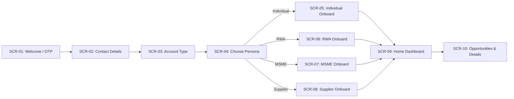

# OTP NEXT — PHASE 2: FRONTEND DESIGN SYSTEM & APPLICATION SHELL SPECIFICATION

**Document Reference:** `OTP-NEXT-PHASE2-SHELL-v1.1`  
**Visual Reference Baseline:** `g:\My Drive\procurement_ui_concept\shots\page-1.png` & `pages\board.page`  
**Canonical Identity Baseline:** Baskar Loganathan (`bvnbasu@gmail.com`)  
**Canonical Community Baseline:** Durga Rainbow Assn (`REG/2013/1234`), Mahadevapura, Bengaluru – 560048  
**Application Target:** Greenfield Mobile-First Experience Layer (`apps/web`)  
**Design Philosophy:** **SIMPLE. SECURE. FAIR.**  
*Same power. Simpler experience. All the intelligence. None of the complexity. The customer makes the decision. OTP does the procurement work.*

---

## 1. EXECUTIVE DESIGN PRINCIPLES & ERGONOMIC TARGETS

The Phase 2 frontend rebuild is anchored on the approved, brand-neutral visual designs from `g:\My Drive\procurement_ui_concept`. It translates complex institutional procurement mechanisms into consumer-familiar, thumb-friendly interfaces.

```
+---------------------------------------------------------------------------------------------------------+
|                                    OTP NEXT ERGONOMIC STANDARDS                                         |
+--------------------------+-----------------------+------------------------------------------------------+
| Ergonomic Factor         | Metric / Standard     | Implementation Rule                                  |
+--------------------------+-----------------------+------------------------------------------------------+
| Viewport Target          | 390px (360px–412px)   | Standard Indian smartphone screen widths (Android/iOS)|
+--------------------------+-----------------------+------------------------------------------------------+
| Primary Touch Targets    | Minimum 48px height   | Full-width bottom action buttons within natural thumb|
|                          |                       | reach zone; no critical actions in top corners.      |
+--------------------------+-----------------------+------------------------------------------------------+
| Secondary Touch Targets  | Minimum 44px x 44px   | All chips, tabs, icon buttons, and list row triggers |
+--------------------------+-----------------------+------------------------------------------------------+
| Card Margins & Spacing   | 16px (px-4) gutters   | 12px–16px card gaps with soft rounded-2xl radii      |
+--------------------------+-----------------------+------------------------------------------------------+
| Typography Scale         | Inter + Noto Indic    | Clear visual hierarchy: 9px tags, 11px captions,     |
|                          |                       | 12px body, 14px subtitles, 20px–22px screen titles  |
+--------------------------+-----------------------+------------------------------------------------------+
| Color Contrast Ratio     | WCAG AAA Compliant    | Deep Navy Slate `#1E3A8A` / `#0F172A` on white cards |
|                          |                       | and cool background `#EDF2F8`; Emerald verified tags |
+--------------------------+-----------------------+------------------------------------------------------+
| Performance & Weight     | Zero bloated UI libs  | Pure Tailwind CSS, React 19, native browser CSS      |
|                          |                       | bottom-sheets, SVGs, zero enterprise CSS overhead    |
+--------------------------+-----------------------+------------------------------------------------------+
```

---

## 2. THE 10 CANONICAL MOBILE SCREENS (VISUAL CONCEPT REFERENCE)

Directly synthesized from `g:\My Drive\procurement_ui_concept\shots\page-1.png` with canonical identity and community parameters:



### Screen 1: Welcome / Registration + Phone-First OTP
* **Visual Anchor:** Blue rounded icon with white handshake (`#2563EB`).
* **Headline:** *"Simpler Procurement for Everyone"*
* **Subheading:** *"Find, compare and choose the best suppliers — all in one place."*
* **Primary Inputs:**
  * Phone Number field with country code prefix (`+91 ▾`) and 10-digit number input (`99729 67530`).
  * Primary Action: **Continue** (48px height, rounded-2xl, blue `#2563EB`).
  * Sign-in switch: *"Already have an account? Sign in"*
* **Bottom-Sheet OTP Verification:**
  * Title: *"Verify Your Phone"*
  * Subtitle: *"We've sent an OTP to +91 99729 67530"*
  * Boxed numeric OTP cells with automatic focus progression and paste handling.
  * Resend timer with countdown (`Resend OTP in 00:45`).
  * Action: **Verify** button + *"Change mobile number"* fallback.
* **Core Rule:** An unverified phone number is never an account.

### Screen 2: Contact Details & Explicit Consent
* **Header:** `← Contact Details`, right: `Step 2 of 5`.
* **Subtitle:** *"We'll use this to keep you updated about your procurement activities."*
* **Fields & Verification Badges:**
  * Registered Mobile Number: Displayed in bold monospace with a green `✓ Verified` badge.
  * Checkbox: `☑ My WhatsApp number is the same as my registered number`.
  * WhatsApp Number: Displayed with green `✓ Verified` badge (`+91 99729 67530`).
  * Email Address: Input field with `✓ Verified` status (`bvnbasu@gmail.com`).
* **Compliance Info Callout (Blue light box):**
  * *"You'll receive transactional updates on WhatsApp and email. Marketing messages need separate consent."*
  * *"You can update these anytime from Profile → Contact Details."*
* **Primary Action:** **Continue** (Pinned to thumb zone).

### Screen 3: Account Type Selection (Buyer vs Supplier)
* **Header:** `← What do you want to do?`, right: `Step 3 of 5`.
* **Subtitle:** *"Select your account type."*
* **Two High-Prominence Selection Cards:**
  * **Buyer Card:** Blue shopping bag icon, Title: *"Buyer"*, Subtitle: *"I want to purchase goods or services."* Radio circle with checkmark.
  * **Supplier Card:** Blue storefront icon, Title: *"Supplier"*, Subtitle: *"I want to sell products or provide services."*
* **Platform Identity Callout:**
  * Identity icon: *"One account, one identity. You can activate another role later — no duplicate registration."*
* **Primary Action:** **Continue**.

### Screen 4: Persona Selection
* **Header:** `← Choose Your Persona`, right: `Step 4 of 5`.
* **Subtitle:** *"This helps us personalise your experience."*
* **Buyer Persona Cards (Section BUYER):**
  1. **Individual:** Blue person icon, *"Individual"*, *"For personal or home use"*.
  2. **RWA / Apartment Assn.:** Blue building icon, *"RWA / Apartment Assn."*, *"For residential communities"*.
  3. **MSME / Business:** Blue briefcase icon, *"MSME / Business"*, *"For small and medium businesses"*.
* **Supplier Persona Cards (Section SUPPLIER):**
  4. **Supplier / Service Provider:** Blue truck icon, *"Supplier / Service Provider"*, *"For businesses supplying goods or services"*.
* **Guardrail:** Enterprise is strictly omitted.

### Screen 5: Individual Guided Onboarding
* **Header:** `← Individual Profile`, right: `1 / 3`.
* **Subtitle:** *"Tell us about yourself — it stays editable."*
* **Personal Information:**
  * Full Name * (**Baskar Loganathan**).
  * Profile Photo (optional) with camera icon: *"Helps suppliers recognise you"*.
  * Preferred Language * (`English ▾`, `Tamil ▾`, `Kannada ▾`, `Hindi ▾`, etc.).
* **Addresses Section (Pre-populated & Extensible):**
  * `HOME • DEFAULT` (Green badge): **Durga Rainbow, Mahadevapura, Bengaluru, Karnataka – 560048**.
  * `WORK` (Blue badge): `Office Tower, MG Road, Bengaluru, Karnataka – 560001`.
  * Button: `+ Add Address` (Dashed border, blue font).
* **Identity & Tax Accordion (Optional):**
  * Dropdown: `Identity & Tax (optional) • PAN • GSTIN ∨`.
* **Primary Action:** **Next**.

### Screen 6: RWA / Apartment Association Onboarding
* **Header:** `← Association Profile`, right: `1 / 3`.
* **Subtitle:** *"Register your community once — reuse it everywhere."*
* **Community Fields:**
  * Association Name * (**Durga Rainbow Assn**).
  * Registration Number * (**REG/2013/1234**).
  * Association Type * (`Apartment Assn. ▾`, `Housing Society ▾`, etc.).
  * Total Units (**141**), Occupied Units (**141**).
  * Association Address * (**Bengaluru, Karnataka – 560048**).
  * Contact Person Name * (**Baskar Loganathan**).
* **Governance Role Selector (Pill buttons):**
  * `Resident Owner` | `Committee Member` (Selected) | `Estate / Facility Mgr`.
* **Constitutional Governance Callout (Green warning box):**
  * User icon: *"You become the association administrator (after verification). Invite members later — Facility Managers get operations only, never voting rights."*
* **Primary Action:** **Next**.

### Screen 7: MSME Business Onboarding
* **Header:** `← Business Profile`, right: `1 / 3`.
* **Subtitle:** *"Tell us about your business."*
* **Commercial Entity Fields:**
  * Business Name * (`Bright Enterprises`).
  * Legal Registered Name * (`Bright Enterprises Pvt. Ltd.`).
  * Business Type * (`Private Limited ▾`, `Proprietorship ▾`, `Partnership ▾`).
  * Industry * (`Manufacturing ▾`, `Commercial Supplies ▾`, etc.).
  * PAN * (`ABCDE1234F ✓` with verified green checkmark).
  * GSTIN * (`29ABCDE1234F1Z5`).
  * Udyam Registration (optional) (`UDYAM-KR-00123`).
  * Year of Establishment (`2015`).
  * Registered Business Address * (`44, Industrial Area, Peenya, Bengaluru – 58`).
  * Primary Contact Person: **Baskar Loganathan**.
* **Delegation Callout (Blue info box):**
  * User-plus icon: *"Invite delegates and assign permissions later from your Business Profile — no committee workflows."*
* **Primary Action:** **Next**.

### Screen 8: Supplier Onboarding & Trust Pipeline
* **Header:** `← Supplier Profile`, right: `2 / 4`.
* **Subtitle:** *"Verification builds buyer trust."*
* **Supplier Type Selector (Pills):**
  * `Manufacturer` | `Distributor` (Selected) | `Retail` | `Service Provider` | `Contractor`.
* **Documents Upload Status:**
  * `PAN`: `✓ Uploaded` (Green badge).
  * `GST Certificate`: `✓ Uploaded` (Green badge).
  * `Bank Proof`: `Pending` (Amber badge).
* **Category Tag Row:**
  * `Categories • Office Furniture, Electrical +3 >`.
* **Verification Pipeline Stepper:**
  * `Submitted` (Green) → `Verifying` (Orange) → `Verified` (Pending) → `Active` (Pending).
* **Identity Shield Callout:**
  * Shield icon: *"Your identity stays hidden from buyers until an award is made."*
* **Primary Action:** **Next**.

### Screen 9: Home Dashboard (Personalized to Persona)
* **Header:**
  * Greeting: **Good morning, Baskar** (dynamic time-of-day greeting).
  * Subheading: `Find what you need, when you need it`.
  * Notification Bell with unread counter badge (`3`).
* **Search Bar:**
  * Search icon + `Search goods, services, suppliers...` with clear button.
* **6-Tile Quick Action Grid (2 columns x 3 rows / 3 columns x 2 rows):**
  1. `My Requirements` (List icon): Active requirements monitoring.
  2. `My Quotes` (Description icon): Buyer quote reviews / Supplier quotes reviews.
  3. `My Orders` (Receipt icon): Toggles expandable orders ledger or /purchase-orders.
  4. `Create RFQ` (Plus icon): 1-tap route to `/requirements/new`.
  5. `Notifications` (Bell icon): Action required alerts.
  6. `Profile` (Person icon): Profile completion & address management.
* **Section RECOMMENDED FOR YOU (Header with "See all"):**
  * Card: `Office Chairs & Furniture` | `Office supplies • Bengaluru` | `Open • 3 days left` | `View` button.
* **Minimal 4-Item Bottom Navigation:**
  * `Home` (Selected, blue house)
  * `Opportunities` (Radar icon)
  * `Orders` (Receipt icon with badge `3`)
  * `Profile` (User avatar)

### Screen 10: Opportunities & Progressive Details
* **Header:** `← Opportunities`.
* **Search & Filters:**
  * Search input: `Search by category, product...`.
  * Filter pills: `All` (Selected blue pill), `Goods` (White pill), `Services` (White pill).
* **Opportunity Cards:**
  * Title, category, location, number of suppliers quoting, days left tag (`Open • 3 days left`).
* **Opportunity Details Bottom-Sheet:**
  * Title & Category icon.
  * Metric row: `Estimated Value: ₹2,00,000 – ₹5,00,000` | `Quantity: 50 Units` | `Expected Timeline: Within 7 days`.
  * Primary Button: **Submit RFQ** (or Submit Quote for suppliers).

---

## 3. PERSONA-SPECIFIC DASHBOARD PROGRESSION

```
+---------------------------------------------------------------------------------------------------------------+
|                                      PERSONA DASHBOARD COMPARISON                                             |
+-------------------+----------------------------+-----------------------------+--------------------------------+
| Persona           | Primary Quick Actions      | Context Summary Card        | Key Pinned Information         |
+-------------------+----------------------------+-----------------------------+--------------------------------+
| 1. Individual     | Create RFQ, My Quotes,     | Active Deliveries &         | Durga Rainbow (Home Default),  |
|    Buyer (Baskar) | My Orders, Profile         | Everyday Home Requirements  | Work address, Active Orders    |
+-------------------+----------------------------+-----------------------------+--------------------------------+
| 2. RWA / Society  | Committee Votes, Quorum,   | Durga Rainbow Assn          | Mahadevapura Bengaluru 560048, |
|    (Durga Rainbow)| Create RFQ, My Orders      | RFQs, Voting Ballots        | 141 units, Committee seats     |
+-------------------+----------------------------+-----------------------------+--------------------------------+
| 3. MSME           | Spend Approval, Create RFQ,| Purchase Orders, Milestone  | Statutory GSTIN, spend caps,   |
|    Business       | My Orders, Team Delegates  | Inspections, Invoices       | registered business location   |
+-------------------+----------------------------+-----------------------------+--------------------------------+
| 4. Supplier       | Radar Alerts, 30-Min Quote,| Active Quoted Opportunities,| Verification status stepper,   |
|    Network        | My Quotes, Orders & WOs    | Performance Tier Scorecard  | Work Order milestones, Catalog |
+-------------------+----------------------------+-----------------------------+--------------------------------+
```

---

## 4. DESIGN SYSTEM TOKENS SPECIFICATION

```css
/* Core Brand-Neutral Design Tokens */
:root {
  --color-primary: #2563EB;          /* Blue 600 - Primary Brand Action */
  --color-primary-hover: #1D4ED8;    /* Blue 700 */
  --color-primary-soft: #EFF6FF;     /* Blue 50 - Active Card Tint */
  --color-canvas: #EDF2F8;           /* Cool Slate - Page Background */
  --color-card: #FFFFFF;             /* Pure White - Surface */
  --color-border: #DFE7F0;           /* Subtle Border Line */
  --color-text-header: #1E3A8A;      /* Blue 900 - High Contrast Headers */
  --color-text-main: #0F172A;        /* Slate 900 - Body Copy */
  --color-text-muted: #64748B;       /* Slate 500 - Captions & Subtitles */
  --color-badge-green: #10B981;      /* Emerald 500 - Verified Status */
  --color-badge-green-bg: #ECFDF5;   /* Emerald 50 */
  --color-badge-amber: #F59E0B;      /* Amber 500 - Pending Status */
  --color-badge-amber-bg: #FEF3C7;   /* Amber 50 */

  --radius-chassis: 42px;            /* Mobile Frame Chassis */
  --radius-card: 16px;               /* rounded-2xl */
  --radius-button: 14px;             /* rounded-xl */
  --radius-pill: 9999px;             /* rounded-full */

  --height-button-primary: 48px;     /* Thumb-zone primary action */
  --height-touch-target: 44px;       /* Minimum tap target */
  --height-bottom-nav: 56px;         /* Compact mobile bottom bar */
}
```

---

## 5. REVERSIBILITY AND VERIFICATION CONFIRMATION

* All occurrences of sample identities updated to **Baskar Loganathan** across Individual, RWA, MSME, and Supplier onboarding forms.
* Individual default address updated to **Durga Rainbow, Mahadevapura, Bengaluru, Karnataka – 560048**.
* RWA society entity updated to **Durga Rainbow Assn**, **REG/2013/1234**, **141 Total Units**, **141 Occupied Units**, **Bengaluru, Karnataka – 560048**.
* TypeScript typecheck clean with zero compiler errors (`tsc --noEmit` exited 0).
