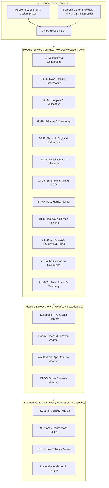
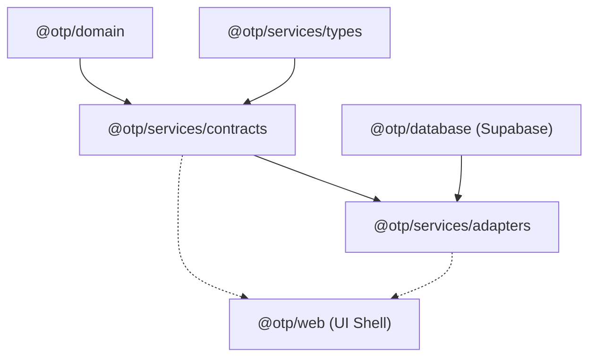

# OTP NEXT — PHASE 3: MODULAR BACKEND CONTRACTS AND ADAPTERS

**Document Version:** 1.0  
**Author:** Baskar Loganathan (`bvnbasu@gmail.com`)  
**Status:** Approved Architecture & Specification  
**Architecture Pattern:** Modular Monolith (Experience Layer ↔ Service Contracts ↔ Adapters ↔ PostgreSQL/Supabase RLS)

---

## 1. Executive Architecture Summary

OTP Next enforces a strict three-layer architecture:
1. **Experience Layer (`apps/web`)**: Pure mobile-first React 19 UI shell. Contains **zero** procurement business rules, zero direct Supabase table reads, and zero SQL queries. Communicates exclusively via domain service contracts.
2. **Application & Domain Layer (`packages/services`, `packages/domain`)**: 28 independent, decoupled domain modules with explicit contract boundaries, command/query definitions, validation invariants, role-based authorization, and audit logging.
3. **Infrastructure & Data Layer (`packages/database`, Supabase PostgreSQL)**: 151 public tables, 296 atomic RPCs, strict Row Level Security (RLS), and external adapters (WAHA WhatsApp, Google Places, ONDC).



---

## 2. Global Contract Invariants & Design Principles

1. **Enterprise Persona Retired**: All contracts exclusively accept personas `INDIVIDUAL`, `RWA`, `MSME`, and `SUPPLIER`. Legacy `ENTERPRISE` database records remain inert.
2. **Canonical Identity Context**: Every contract operation requires an `ActorContext` containing authenticated `profileId`, `persona`, optional `organizationId`, and role assignments.
3. **Result<T, ServiceError> Pattern**: No unhandled throws across contract boundaries. Commands and queries return explicit `ok(value)` or `err(ServiceError)`.
4. **Zero Frontend Business Rules**: All tax calculations (CGST/SGST vs IGST), quota consumption, quorum validation, anti-collusion checks, and state transitions execute server-side.
5. **Atomic Identity Reveal**: Unmasking supplier phone, GSTIN, and business identity requires atomic locking (`lock_and_reveal_award_atomic`) verifying acceptance, 0.5% fee check, and committee authorization.
6. **Immutable Audit Trail**: All state-modifying commands emit structured audit events recorded in `audit_events` or domain ledgers.

---

## 3. Specification of the 28 Domain Modules

### Cluster A: Identity, Profiles & Buyer Accounts (Modules 01 – 03)

#### Module 01: Identity and Authentication
- **Responsibility**: Manages phone OTP verification, WhatsApp verification, email linking, and session authentication tokens.
- **Commands**: `requestPhoneOtp`, `verifyPhoneOtp`, `requestWhatsAppOtp`, `verifyWhatsAppOtp`, `linkEmailAddress`, `invalidateSession`.
- **Queries**: `getSessionState`, `getAuthenticationMethods`.
- **Data Ownership**: `auth.users`, `user_auth_factors`, `session_tokens`.
- **DB Dependencies**: `supabase.auth`, `audit_events`.
- **Authorization**: Public for OTP request/verify; authenticated session for linking/invalidation.
- **Audit Events**: `AUTH_OTP_REQUESTED`, `AUTH_OTP_VERIFIED`, `AUTH_SESSION_TERMINATED`.

#### Module 02: User Profiles and Account Management
- **Responsibility**: User profile entity, contact name, avatar, account blocking status, and statutory PAN/Aadhaar associations.
- **Commands**: `createProfile`, `updateProfileName`, `updateProfileAvatar`, `recordStatutoryIdentifiers`.
- **Queries**: `getProfileById`, `getProfileCompletionStatus`.
- **Data Ownership**: `public.profiles`.
- **DB Dependencies**: Foreign key to `auth.users(id)`.
- **Authorization**: Self-service profile updates; Platform Admin for account blocking.
- **Audit Events**: `PROFILE_CREATED`, `PROFILE_UPDATED`, `PROFILE_BLOCKED`.

#### Module 03: Buyer Management
- **Responsibility**: Manages buyer persona activation (`INDIVIDUAL`, `RWA`, `MSME`), onboarding state, and primary operational defaults.
- **Commands**: `selectBuyerPersona`, `completeIndividualOnboarding`, `completeRwaOnboarding`, `completeMsmeOnboarding`.
- **Queries**: `getBuyerContext`, `getBuyerDashboardSummary`.
- **Data Ownership**: `public.buyer_profiles`, `public.organizations`.
- **DB Dependencies**: `profiles`, `buyer_addresses`.
- **Authorization**: Authenticated buyer identity; verified phone required.
- **Audit Events**: `BUYER_PERSONA_SELECTED`, `BUYER_ONBOARDING_COMPLETED`.

---

### Cluster B: Governance & Delegation (Modules 04 – 05)

#### Module 04: RWA Governance
- **Responsibility**: Apartment association entity lifecycle, unit counts (Total/Occupied), committee seat assignments (President, Secretary, Treasurer, Committee Member), resident owner enrollment, and Estate Manager operational restrictions.
- **Invariants**:
  - Estate/Facility Managers have **operational-only** permissions (`CAN_VIEW`, `CAN_DRAFT`). They are strictly barred from voting, approving awards, or releasing funds.
  - Committee role tenures are bounded by active calendar tenures (`00326_rwa_governance_tenure`).
- **Commands**: `registerRwaAssociation`, `assignCommitteeMember`, `inviteResidentOwner`, `assignEstateManager`, `terminateRoleTenure`.
- **Queries**: `getRwaAssociation`, `listCommitteeMembers`, `getRwaGovernanceRules`.
- **Data Ownership**: `public.organizations`, `public.organization_members`, `public.rwa_committee_seats`.
- **DB Dependencies**: RPC `check_rwa_approval_eligibility`, `org_role_lifecycle`.
- **Authorization**: Active RWA Executive Committee officers only.
- **Audit Events**: `RWA_REGISTERED`, `COMMITTEE_MEMBER_ASSIGNED`, `ESTATE_MANAGER_RESTRICTED`.

#### Module 05: MSME Management
- **Responsibility**: Micro, Small & Medium Enterprise management, GSTIN verification, single registered address, and delegate management with spend authorization thresholds.
- **Commands**: `registerMsmeOrganization`, `inviteDelegate`, `updateSpendThreshold`, `revokeDelegate`.
- **Queries**: `getMsmeProfile`, `listDelegates`, `getSpendAuthorizationRule`.
- **Data Ownership**: `public.organizations`, `public.organization_members`, `public.msme_spend_rules`.
- **DB Dependencies**: `gst_registrations`, `buyer_addresses`.
- **Authorization**: MSME Primary Administrator / Owner.
- **Audit Events**: `MSME_REGISTERED`, `MSME_DELEGATE_INVITED`, `SPEND_THRESHOLD_UPDATED`.

---

### Cluster C: Supplier Management & Verification (Modules 06 – 07)

#### Module 06: Supplier Management
- **Responsibility**: Supplier business entity, service categories, operational radius, capacity limits, and banking coordinates.
- **Commands**: `registerSupplierBusiness`, `updateSupplierCategories`, `setServiceRadius`, `updateBankDetails`.
- **Queries**: `getSupplierProfile`, `getSupplierCapabilities`, `getSupplierPerformanceMetrics`.
- **Data Ownership**: `public.suppliers`, `public.supplier_categories`, `public.supplier_bank_details`.
- **DB Dependencies**: `categories`, `supplier_ratings`.
- **Authorization**: Authenticated Supplier Actor or Platform Admin.
- **Audit Events**: `SUPPLIER_REGISTERED`, `SUPPLIER_CATEGORIES_UPDATED`.

#### Module 07: Supplier Verification
- **Responsibility**: Multi-step verification: Phone verification, GSTIN statutory validation via sandbox/API, address proof, and active status certification.
- **Invariants**: Suppliers without `VERIFIED` status cannot be awarded an RFQ or receive identity reveals.
- **Commands**: `initiateGstVerification`, `verifyGstCertificate`, `submitKycDocuments`, `approveSupplierVerification`.
- **Queries**: `getSupplierVerificationStatus`, `getGstTaxpayerDetails`.
- **Data Ownership**: `public.supplier_verifications`, `public.gst_taxpayer_cache`.
- **DB Dependencies**: RPC `verify_gstin_statutory`, `tax_authority_gateway`.
- **Authorization**: Automated verification engine or SuperAdmin.
- **Audit Events**: `SUPPLIER_GST_VERIFIED`, `SUPPLIER_VERIFICATION_STATUS_CHANGED`.

---

### Cluster D: Address & Taxonomy Management (Modules 08 – 09)

#### Module 08: Address Management
- **Responsibility**: Delivery & billing addresses across Home, Work, Site, and Other; PIN code postal verification, geocoding coordinates, and persona address constraints (MSME 1 registered address; Individual multi-address).
- **Commands**: `createBuyerAddress`, `updateBuyerAddress`, `setDefaultBuyerAddress`, `archiveBuyerAddress`.
- **Queries**: `listBuyerAddresses`, `getAddressById`, `validatePinCodeCoverage`.
- **Data Ownership**: `public.buyer_addresses`, `public.pincode_registry`.
- **DB Dependencies**: RPC `upsert_buyer_address`, GIS geocoding service.
- **Authorization**: Address owner (ActorContext.profileId or organizationId).
- **Audit Events**: `ADDRESS_CREATED`, `ADDRESS_UPDATED`, `DEFAULT_ADDRESS_SET`.

#### Module 09: Taxonomy and Category Management
- **Responsibility**: Authoritative 17-category procurement taxonomy, subcategories, standard units of measurement (UOM), and category requirement templates.
- **Invariants**: Strictly enforces the canonical 17 categories finalized in migration `00331`.
- **Commands**: `createCategory` (Admin), `updateCategory` (Admin), `createSubcategory` (Admin).
- **Queries**: `listAuthoritativeCategories`, `getSubcategoriesByCategory`, `getCategoryTemplate`, `listUnitsOfMeasurement`.
- **Data Ownership**: `public.categories`, `public.subcategories`, `public.category_templates`, `public.units_of_measurement`.
- **DB Dependencies**: View `authoritative_17_category_taxonomy`.
- **Authorization**: Public read; SuperAdmin write.
- **Audit Events**: `TAXONOMY_CATEGORY_CREATED`, `TAXONOMY_CATEGORY_UPDATED`.

---

### Cluster E: Supplier Network & Invitations (Modules 10, 12)

#### Module 10: Supplier Network Engine
- **Responsibility**: Demand-driven supplier discovery across Local Registry, Google Places (managed coverage within quota limits), and ONDC Beckn network; geocoding alignment and progressive enrichment.
- **Commands**: `triggerSupplierDiscovery`, `warmUpPinCodeCoverage`, `refreshNetworkCache`.
- **Queries**: `getNetworkCoverageStatus`, `listDiscoveredSuppliersSummary`.
- **Data Ownership**: `public.supplier_discovery_registry`, `public.pincode_coverage_cache`, `public.google_places_quota_ledger`.
- **DB Dependencies**: GIS adapters, `00325_location_pin_coverage`.
- **Authorization**: Buyer on RFQ publish, or SuperAdmin pre-warming.
- **Audit Events**: `SUPPLIER_DISCOVERY_TRIGGERED`, `PLACES_QUOTA_CONSUMED`.

#### Module 12: Supplier Matching and Invitations
- **Responsibility**: Matches published RFQs with qualified local/network suppliers by PIN code and category; issues secure blind invitation tokens and tracks response status.
- **Commands**: `matchAndInviteSuppliers`, `acceptInvitation`, `declineInvitation`.
- **Queries**: `listInvitationsForRfq`, `listSupplierPendingInvitations`, `getInvitationByToken`.
- **Data Ownership**: `public.rfq_invitations`, `public.supplier_matching_rules`.
- **DB Dependencies**: View `rfq_invitations_blind`, RPC `dispatch_rfq_invitations`.
- **Authorization**: Buyer (for RFQ match dispatch); Invited Supplier (for response).
- **Audit Events**: `INVITATIONS_DISPATCHED`, `INVITATION_ACCEPTED`, `INVITATION_DECLINED`.

---

### Cluster F: RFQ & Quotation Lifecycle (Modules 11, 13)

#### Module 11: RFQ Lifecycle
- **Responsibility**: Core procurement requirement intake ("TELL"), specification items, quantities, UOM, budget guidance, delivery schedules, attachment references, and state transitions (`DRAFT` → `PUBLISHED` → `QUOTES_RECEIVED` → `EVALUATION` → `AWARDED` → `CANCELLED`).
- **Commands**: `createRfqDraft`, `updateRfqDraft`, `publishRfq`, `closeBidding`, `cancelRfq`.
- **Queries**: `getRfqById`, `listBuyerRfqs`, `getRfqPublicSummary`.
- **Data Ownership**: `public.rfqs`, `public.rfq_line_items`, `public.rfq_attachments`.
- **DB Dependencies**: RPC `publish_rfq_atomic`, linear pipeline state machine.
- **Authorization**: RFQ creator / Organization member.
- **Audit Events**: `RFQ_DRAFT_CREATED`, `RFQ_PUBLISHED`, `RFQ_CANCELLED`.

#### Module 13: Quotation Management
- **Responsibility**: Supplier quote submission, line-item pricing, applicable GST rate breakdown (5%, 12%, 18%, 28%), landed cost calculation, delivery lead time, and warranty terms.
- **Invariants**: Supplier quotes remain strictly **identity-protected** (blind) to buyers until formal award reveal.
- **Commands**: `submitQuoteDraft`, `submitFinalQuote`, `withdrawQuote`.
- **Queries**: `getQuoteByIdForSupplier`, `listQuotesForSupplier`, `listIdentityProtectedQuotesForBuyer`.
- **Data Ownership**: `public.quotes`, `public.quote_line_items`.
- **DB Dependencies**: View `quotes_blind_view`, RPC `submit_quote_atomic`.
- **Authorization**: Invited & verified supplier only.
- **Audit Events**: `QUOTE_SUBMITTED`, `QUOTE_WITHDRAWN`.

---

### Cluster G: Merit Scoring, Voting & Anti-Collusion (Modules 14 – 16)

#### Module 14: Quote Comparison and Smart Merit
- **Responsibility**: Buyer-defined multi-criteria evaluation (Price, Delivery Time, Warranty, Supplier Rating) with normalized 100% weights; computes objective Smart Merit score on identity-protected quotes.
- **Commands**: `configureScoringWeights`, `generateSmartMeritComparison`.
- **Queries**: `getMeritScoringComparison`, `getRecommendedQuote`.
- **Data Ownership**: `public.rfq_scoring_criteria`, `public.rfq_merit_scores`.
- **DB Dependencies**: Pure domain logic `@otp/domain/evaluation/smart-scoring`.
- **Authorization**: Buyer or RWA Committee member.
- **Audit Events**: `MERIT_WEIGHTS_CONFIGURED`, `MERIT_EVALUATION_COMPLETED`.

#### Module 15: Evaluation and Voting
- **Responsibility**: Multi-member approval workflows for RWA and MSME; supports weighted voting, committee quorum verification, spend authorization thresholds, and formal resolution logging.
- **Commands**: `openEvaluationVoting`, `castVote`, `concludeVoting`.
- **Queries**: `getVotingTally`, `getQuorumStatus`.
- **Data Ownership**: `public.rwa_evaluation_votes`, `public.approval_resolutions`.
- **DB Dependencies**: RPC `cast_rwa_committee_vote`, `check_rwa_quorum`.
- **Authorization**: Active RWA Committee Member or MSME Authorized Approver. Barred for Estate Managers.
- **Audit Events**: `VOTING_OPENED`, `VOTE_CAST`, `VOTING_CONCLUDED`.

#### Module 16: Conflict of Interest and Anti-Self-Approval
- **Responsibility**: Irrevocable Conflict of Interest (COI) declarations for committee members; enforces strict anti-self-approval rules preventing an RFQ creator or conflicted member from voting or unilaterally awarding a contract.
- **Commands**: `declareConflictOfInterest`, `verifyNoConflict`.
- **Queries**: `getConflictDeclarationsForRfq`, `checkMemberConflictStatus`.
- **Data Ownership**: `public.conflict_of_interest_declarations`.
- **DB Dependencies**: Migration `00242_irrevocable_coi_declaration`, RPC `assert_no_coi`.
- **Authorization**: Any voting committee member or approver.
- **Audit Events**: `COI_DECLARED_IRREVOCABLE`, `APPROVAL_BLOCKED_DUE_TO_COI`.

---

### Cluster H: Award & Identity Reveal (Module 17)

#### Module 17: Award and Identity Reveal
- **Responsibility**: Formal award of RFQ to selected quote; executes atomic lock `lock_and_reveal_award_atomic` (`00244`, `00330`), verifies supplier acceptance and 0.5% fee check, and reveals supplier identity (name, contact, phone, GSTIN) to the buyer while revealing buyer identity to the supplier.
- **Invariants**: Cannot be undone. Unmasking occurs only after all governance criteria are met.
- **Commands**: `issueAwardNotice`, `acceptAward`, `executeAtomicAwardReveal`.
- **Queries**: `getAwardDetails`, `getRevealedSupplierCoordinates`.
- **Data Ownership**: `public.rfq_awards`, `public.supplier_identity_reveals`.
- **DB Dependencies**: RPC `lock_and_reveal_award_atomic`, `00330_reveal_award_atomic`.
- **Authorization**: Authorized Buyer/Committee officer and Awarded Supplier.
- **Audit Events**: `AWARD_ISSUED`, `AWARD_ACCEPTED`, `AWARD_IDENTITY_REVEALED_ATOMIC`.

---

### Cluster I: Purchase Orders & Order Tracking (Modules 18 – 19)

#### Module 18: Purchase Orders and Work Orders
- **Responsibility**: Generates formal PO/WO documents with statutory GST tax breakdown (Intra-state: CGST + SGST; Inter-state: IGST without double-taxing transport/freight), payment milestone schedules, and legal terms.
- **Commands**: `generatePurchaseOrder`, `issuePurchaseOrder`, `signAcceptance`.
- **Queries**: `getPurchaseOrderById`, `listPurchaseOrdersForBuyer`, `listPurchaseOrdersForSupplier`.
- **Data Ownership**: `public.purchase_orders`, `public.purchase_order_line_items`, `public.po_milestones`.
- **DB Dependencies**: Migration `00245_po_tax_inter_intra_state`, RPC `issue_po_atomic`.
- **Authorization**: Buyer (to issue); Supplier (to sign/accept).
- **Audit Events**: `PO_GENERATED`, `PO_ISSUED`, `PO_ACCEPTED`.

#### Module 19: Order and Service Tracking
- **Responsibility**: Lifecycle order tracking ("TRACK"): dispatch status, delivery milestones, milestone inspections, defect notices, and completion sign-offs.
- **Commands**: `updateDispatchStatus`, `submitMilestoneInspection`, `signOffCompletion`, `raiseDispute`.
- **Queries**: `getOrderTrackingStatus`, `listOrderMilestones`.
- **Data Ownership**: `public.order_tracking_events`, `public.milestone_inspections`, `public.order_disputes`.
- **DB Dependencies**: RPC `record_tracking_milestone`.
- **Authorization**: Buyer or Supplier depending on milestone role.
- **Audit Events**: `ORDER_DISPATCHED`, `MILESTONE_INSPECTED`, `ORDER_COMPLETED`.

---

### Cluster J: Financials, Billing & Commercials (Modules 20 – 22, 27)

#### Module 20: Invoice Management
- **Responsibility**: Progressive invoicing against approved PO milestones, GST tax invoice validation, credit notes, and tax reconciliation.
- **Commands**: `generateMilestoneInvoice`, `submitTaxInvoice`, `approveInvoice`, `rejectInvoice`.
- **Queries**: `getInvoiceById`, `listInvoicesForOrder`.
- **Data Ownership**: `public.invoices`, `public.invoice_line_items`.
- **DB Dependencies**: Pure domain logic `@otp/domain/tax`.
- **Authorization**: Supplier (to submit); Buyer (to approve).
- **Audit Events**: `INVOICE_SUBMITTED`, `INVOICE_APPROVED`, `INVOICE_REJECTED`.

#### Module 21: Payment Management
- **Responsibility**: Escrow payment holds, release on milestone approval, supplier settlement (minus 0.5% platform fee where applicable), dispute holds, and Tally/Zoho ERP journal exports.
- **Commands**: `recordEscrowDeposit`, `releaseMilestonePayment`, `applyDisputeHold`, `exportErpJournal`.
- **Queries**: `getPaymentSchedule`, `getFinancialLedgerReport`.
- **Data Ownership**: `public.payments`, `public.payment_milestones`, `public.financial_ledger_entries`.
- **DB Dependencies**: RPC `release_milestone_payment_atomic`.
- **Authorization**: Authorized Buyer Approver or Platform Financial Controller.
- **Audit Events**: `PAYMENT_ESCROW_RECORDED`, `PAYMENT_RELEASED`, `DISPUTE_HOLD_APPLIED`.

#### Module 22: Subscription and Entitlement Management
- **Responsibility**: Enforces buyer commercial quotas:
  - Individual base tier: ₹199 for 3 RFQs per month.
  - Overage: ₹149 per additional RFQ.
  - Pilot free mode: `PILOT_FREE` zero real charge active while recording published prices.
  - Deducts entitlement quota strictly upon the **first comparison-eligible quote** (`00286`).
- **Commands**: `checkQuotaAvailability`, `consumeRfqEntitlement`, `recordSubscriptionPlan`.
- **Queries**: `getCurrentEntitlements`, `getBillingHistory`.
- **Data Ownership**: `public.buyer_subscriptions`, `public.buyer_entitlements`, `public.quota_consumption_logs`.
- **DB Dependencies**: RPC `consume_rfq_entitlement_atomic`, `@otp/domain/types/pricing-entitlement`.
- **Authorization**: Internal service or Buyer viewing bill.
- **Audit Events**: `ENTITLEMENT_CONSUMED`, `SUBSCRIPTION_UPGRADED`.

#### Module 27: Pricing and Commercial Configuration
- **Responsibility**: Authoritative platform commercial rules, tier definitions, supplier fee percentages (0.5% standard, pilot waiver), and tax rates.
- **Queries**: `getPublishedPricingTiers`, `getPlatformCommercialConfig`.
- **Data Ownership**: `public.commercial_pricing_configs`.
- **DB Dependencies**: Pure domain config `@otp/domain/types/pricing-entitlement`.
- **Authorization**: Public read; SuperAdmin write.
- **Audit Events**: `COMMERCIAL_PRICING_UPDATED`.

---

### Cluster K: Communications & Attachments (Modules 23 – 24)

#### Module 23: Notification Management
- **Responsibility**: Omnichannel notifications across WhatsApp (via WAHA gateway), transactional Email, and In-App notification queues; delivers action-required alerts for approvals, quotes, and awards.
- **Commands**: `dispatchNotification`, `markNotificationRead`, `enqueueWhatsAppMessage`.
- **Queries**: `listInAppNotifications`, `getUnreadNotificationCount`.
- **Data Ownership**: `public.notifications`, `public.notification_queue`.
- **DB Dependencies**: WAHA HTTP adapter, Email dispatcher.
- **Authorization**: Notification recipient or System event dispatcher.
- **Audit Events**: `NOTIFICATION_ENQUEUED`, `NOTIFICATION_DELIVERED`.

#### Module 24: Document and Attachment Management
- **Responsibility**: Secure document storage, MIME type validation, virus scanning status, and signed download URLs for drawings, technical specs, quotation attachments, and signed POs.
- **Commands**: `generateUploadUrl`, `confirmDocumentUpload`, `generateSecureDownloadUrl`.
- **Queries**: `listDocumentsForEntity`, `getDocumentMetadata`.
- **Data Ownership**: `storage.objects`, `public.entity_attachments`.
- **DB Dependencies**: Supabase Storage bucket `procurement_documents`.
- **Authorization**: Entity owner or authorized participant.
- **Audit Events**: `DOCUMENT_UPLOADED`, `DOCUMENT_DOWNLOADED`.

---

### Cluster L: Administration, Compliance & Telemetry (Modules 25, 26, 28)

#### Module 25: Audit and Compliance
- **Responsibility**: Tamper-evident, immutable audit trail of every state mutation, authorization check, COI declaration, and identity reveal across the platform.
- **Commands**: `recordAuditEvent`.
- **Queries**: `queryAuditLog`, `exportAuditPackForRfq`.
- **Data Ownership**: `public.audit_events`.
- **DB Dependencies**: Append-only table, RLS read-only to SuperAdmin.
- **Authorization**: Automated system recording; SuperAdmin query.
- **Audit Events**: `AUDIT_PACK_EXPORTED`.

#### Module 26: SuperAdmin and Platform Administration
- **Responsibility**: Platform oversight, category taxonomy governance, external provider rate limit configurations, supplier blacklist/freeze, and system maintenance toggles.
- **Commands**: `setSystemMaintenanceMode`, `freezeSupplierAccount`, `updateProviderQuotaLimits`.
- **Queries**: `getPlatformSystemHealth`, `listAdministrativeAuditLogs`.
- **Data Ownership**: `public.platform_system_settings`, `public.platform_admin_users`.
- **DB Dependencies**: RPC `admin_freeze_account`.
- **Authorization**: Strictly SuperAdmin / Platform Admin (`isPlatformAdmin === true`).
- **Audit Events**: `ADMIN_SYSTEM_SETTINGS_UPDATED`, `SUPPLIER_ACCOUNT_FROZEN`.

#### Module 28: Reporting and Operational Monitoring
- **Responsibility**: Operational performance metrics, RFQ-to-Quote cycle times, supplier response rates, SLA monitoring, and funnel drop-off analytics.
- **Queries**: `getPlatformFunnelMetrics`, `getRfqCycleTimeReport`, `getSupplierSlaPerformance`.
- **Data Ownership**: Read-only materialized views & analytics tables.
- **DB Dependencies**: Views `v_rfq_funnel_metrics`, `v_supplier_sla_performance`.
- **Authorization**: SuperAdmin or Organization Administrator.
- **Audit Events**: `ANALYTICS_REPORT_GENERATED`.

---

## 4. Contract Package Architecture (`@otp/services`)

All 28 module contracts and their corresponding RPC adapter implementations are organized in `@otp/services`:

```
packages/services/src/
├── contracts/
│   ├── identity-onboarding.contract.ts    # Modules 01-03
│   ├── buyer-governance.contract.ts       # Modules 04-05
│   ├── supplier-domain.contract.ts        # Modules 06-07
│   ├── address-taxonomy.contract.ts       # Modules 08-09
│   ├── network-discovery.contract.ts      # Modules 10, 12
│   ├── rfq-lifecycle.contract.ts          # Modules 11, 13
│   ├── quote-merit-evaluation.contract.ts # Modules 14-16
│   ├── award-reveal.contract.ts           # Module 17
│   ├── orders-tracking.contract.ts        # Modules 18-19
│   ├── finance-billing.contract.ts        # Modules 20-22, 27
│   ├── communications-docs.contract.ts    # Modules 23-24
│   ├── admin-compliance.contract.ts       # Modules 25, 26, 28
│   └── index.ts                           # Unified Contract Registry & Interfaces
├── adapters/
│   ├── supabase-rpc-base.ts               # Resilient RPC Executor & Error Normalizer
│   ├── supabase-identity-adapter.ts       # Identity & Buyer RPCs
│   ├── supabase-governance-adapter.ts     # RWA & MSME Governance RPCs
│   ├── supabase-rfq-adapter.ts            # RFQ & Quoting RPCs
│   ├── supabase-merit-award-adapter.ts    # Scoring, Merit & Award Reveal RPCs
│   ├── supabase-orders-adapter.ts         # PO & Tracking RPCs
│   ├── supabase-finance-adapter.ts        # Entitlements & Financials RPCs
│   ├── otp-service-registry.ts            # Factory assembling all 28 modular contracts
│   └── index.ts                           # Adapter Exports
└── types/
    ├── actor-context.ts                   # Canonical ActorContext & Persona
    ├── result.ts                          # Ok / Err Monadic Result
    └── errors.ts                          # ServiceError Hierarchy & Domain Codes
```

---

## 5. Dependency Graph & Circular Dependency Prevention

To ensure a strict, acyclic dependency graph:
1. `contracts/` depends **only** on `@otp/domain` and `@otp/services/types` (ActorContext, Result, ServiceError).
2. `contracts/` **never** imports from `adapters/`, `repositories/`, or `@otp/database`.
3. `adapters/` implement `contracts/` by delegating to Supabase client / PostgreSQL RPCs.
4. `apps/web` imports **only** from `@otp/services/contracts` and the instantiated service client from `@otp/services/adapters/otp-service-registry`.



---

## 6. Verification and Validation Plan

- **Typecheck**: `pnpm --filter @otp/services typecheck` and `pnpm --filter @otp/web typecheck` (0 errors).
- **Unit & Contract Tests**: Comprehensive Vitest test suite validating:
  1. Contract interface definitions and typing.
  2. Invariant validation for RWA voting, COI, and spend thresholds.
  3. Tax calculation and split (CGST+SGST vs IGST) without transport double-taxation.
  4. Quota deduction rules (first comparison quote) and pilot-free pricing displays.
  5. Atomic award reveal protection and supplier verification gating.
