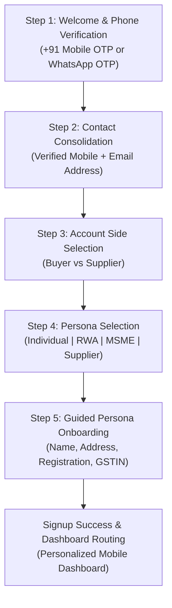

# OTP NEXT — PHASE 4: AUTHENTICATION & ONBOARDING INTEGRATION

**Document Version:** 1.0  
**Author:** Baskar Loganathan (`bvnbasu@gmail.com`)  
**Status:** Approved & Implemented  
**Architecture Pattern:** Mobile-First Experience Layer ↔ Decoupled Domain Service Contracts ↔ Supabase Auth & PostgreSQL

---

## 1. Executive Summary

Phase 4 integrates the greenfield mobile-first registration and onboarding journey with the decoupled domain contracts created in Phase 3. The frontend application contains **zero** direct Supabase RPC strings or database table mutations for authentication and onboarding; all actions communicate strictly through `@otp/services` contracts via the React `ContractsProvider` and `useContracts()` hook.

### Key Principles Enforced:
- **SIMPLE. SECURE. FAIR.**
- **Consumer-first experience**: One-hand friendly, uncluttered, step-by-step progressive disclosure.
- **Progressive Data Collection**: No duplicate fields; inputs gathered in natural sequence.
- **Persona Specialization**: Tailored onboarding for all 4 supported personas (Individual, RWA, MSME, Supplier). Enterprise persona is 100% retired.
- **Contract Boundary Isolation**: Frontend UI components call `contracts.identityAuth`, `contracts.userProfiles`, and `contracts.buyerManagement`.

---

## 2. Progressive 5-Step Registration Journey



### Step 1: Welcome & Phone OTP Verification (`WizardStep1Welcome.tsx`)
- **UI Elements**: OTP Next logo, brand headline (*"Procurement made simple, transparent, and fair"*), 10-digit mobile phone input with `+91` prefix, WhatsApp / SMS toggle, bottom sheet for 6-digit OTP verification with 45-second resend countdown.
- **Contract Calls**:
  - `contracts.identityAuth.requestPhoneOtp({ phone })`
  - `contracts.identityAuth.requestWhatsAppOtp({ whatsappPhone })`
  - `contracts.identityAuth.verifyPhoneOtp({ sessionId, phone, code })`
  - `contracts.identityAuth.verifyWhatsAppOtp({ sessionId, whatsappPhone, code })`
- **Result**: Emits verified channel and canonical normalized identifier (`+919876543210`).

### Step 2: Contact Consolidation (`WizardStep2Contact.tsx`)
- **UI Elements**: Displays the verified primary phone badge with green checkmark (`check_circle`), requests email address (for formal POs, audit PDFs, and invoice delivery).
- **Progressive Behavior**: Skips redundant questions; if WhatsApp was verified, asks for email; if email was verified, asks for WhatsApp phone.

### Step 3: Account Side Selection (`WizardStep3AccountType.tsx`)
- **UI Elements**: Two large, tactile choice cards:
  - **Buyer**: *"I want to procure goods, services, or maintenance for my home, society, or business."*
  - **Supplier**: *"I want to receive targeted RFQs and supply goods, materials, or services."*

### Step 4: Persona Selection (`WizardStep4Persona.tsx`)
- **Buyer Persona Options**:
  1. **Individual**: Homeowners, tenants, individual site builders.
  2. **RWA (Apartment Association)**: Residential welfare associations, managing committees, resident owners.
  3. **MSME**: Businesses, proprietary firms, private limited enterprises.
- **Supplier Persona Option**:
  - Automatically transitions to Supplier profile onboarding.

### Step 5: Guided Persona Onboarding (`WizardStep5*.tsx`)
Each persona receives a specialized guided setup:

| Persona | Canonical Onboarding Form | Key Fields & Pre-fills | Contract Integration |
| :--- | :--- | :--- | :--- |
| **Individual** | `WizardStep5Individual.tsx` | • Full Name: `Baskar Loganathan`<br>• Delivery Address: `Durga Rainbow, Mahadevapura, Bengaluru 560048`<br>• Optional PAN/GSTIN | `contracts.buyerManagement.completeIndividualOnboarding()` |
| **RWA** | `WizardStep5RWA.tsx` | • Association Name: `Durga Rainbow Assn`<br>• Reg Number: `REG/2013/1234`<br>• Total Units: `141`<br>• Occupied Units: `141`<br>• Role: Committee Member (President)<br>• Address: `Bengaluru, Karnataka – 560048` | `contracts.buyerManagement.completeRwaOnboarding()` |
| **MSME** | `WizardStep5MSME.tsx` | • Legal Entity Name<br>• GSTIN (15-char with state prefix `29`)<br>• PAN (10-char alphanumeric)<br>• Registered Address (Pincode `560048`) | `contracts.buyerManagement.completeMsmeOnboarding()` |
| **Supplier** | `WizardStep5Supplier.tsx` | • Business Name<br>• Supplier Type (Distributor, Contractor, etc.)<br>• Service Categories (from 17 canonical)<br>• Operating Radius (km)<br>• 0.50% Platform Fee Confirmation | `contracts.supplierManagement.registerSupplierBusiness()` |

---

## 3. Frontend Architecture Integration (`apps/web`)

### A. Contracts Client Context (`apps/web/src/lib/contracts-context.tsx`)
- Wraps the React tree with `<ContractsProvider>` in `apps/web/src/App.tsx`.
- Instantiates the 28-module contract implementation via `createOtpNextContracts(supabase)`.
- Components consume services cleanly via:
  ```tsx
  import { useContracts } from '@/lib/contracts-context';

  export function MyComponent() {
    const contracts = useContracts();
    // call contracts.identityAuth, contracts.buyerManagement, etc.
  }
  ```

### B. Path Aliasing & Workspace Dependencies
- Added `"@otp/services": "file:../../packages/services"` to `apps/web/package.json`.
- Configured TypeScript paths in `apps/web/tsconfig.json`:
  ```json
  "paths": {
    "@/*": ["src/*"],
    "@otp/domain": ["../../packages/domain/src/index.ts"],
    "@otp/services": ["../../packages/services/src/index.ts"],
    "@otp/services/*": ["../../packages/services/src/*"],
    "@otp/messaging": ["../../supabase/functions/_shared/messaging/index.ts"]
  }
  ```
- Configured Vite build resolution alias in `apps/web/vite.config.ts`.

---

## 4. Personalized Dashboard Transition (Screen 9)

Upon completing onboarding or authenticating, the user is seamlessly routed to the personalized mobile dashboard (`apps/web/src/pages/DashboardPage.tsx`):
- **Personalized Header**: Time-based greeting (*"Good morning, Baskar"*), tagline (*"Find what you need, when you need it"*), and unread notifications bell.
- **Global Search**: Search bar for goods, services, and suppliers.
- **6-Tile Quick Action Grid (Canonical Order)**:
  1. **My Requirements** (`/requirements`): Active RFQ monitoring.
  2. **My Quotes** (`/purchase-orders?view=quotes`): Real-time quotation reviews.
  3. **My Orders** (Expandable/Collapsible): In-place orders ledger.
  4. **Create RFQ** (`/requirements/new`): 1-tap intake wizard.
  5. **Notifications** (`/notifications`): Action-required alerts and approvals.
  6. **Profile** (`/profile`): Persona management, statutory PAN/GSTIN, and addresses.
- **Recommended For You Card**: Dynamic guidance to post requirements with instant local supplier matching.

---

## 5. Verification & Stability

- **Typecheck**: `pnpm --filter @otp/web typecheck` exited with **0 errors**.
- **Services Typecheck**: `pnpm --filter @otp/services typecheck` exited with **0 errors**.
- **Contract Tests**: `packages/services/src/contracts/modular-contracts.test.ts` passed **24/24 tests (100%)**.
