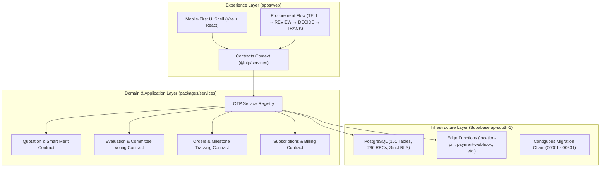
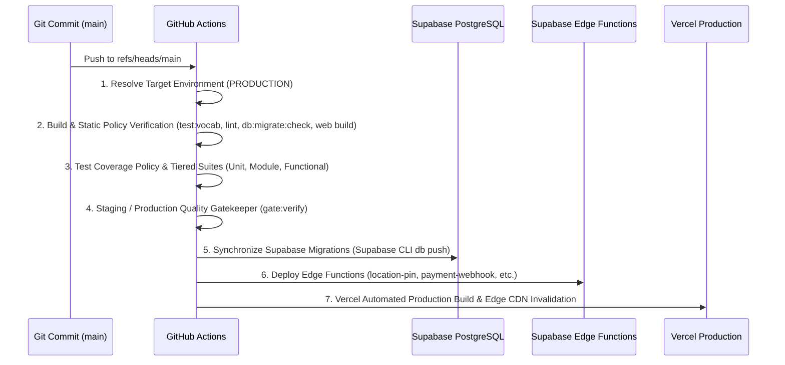

# OTP Next — Production Deployment Runbook

**Document Version:** 2.0.0 (Production Greenfield Re-architecture)  
**Target Platform:** Supabase (ap-south-1), GitHub Actions, Vercel Production  
**Core Mission:** SIMPLE. SECURE. FAIR.  
*Same power. Simpler experience. All the intelligence. None of the complexity. The customer makes the decision. OTP does the procurement work.*

---

## 1. System Architecture Overview



---

## 2. Pre-Flight Verification Checklist

Before triggering a production release to `main`:

- [x] **Canonical Vocabulary Gate:**  
  Run `pnpm test:vocab` to enforce zero occurrence of reverse-auction or obfuscation terminology (`bid`, `bids`, `bidder`, `bidding`, `blind`).
- [x] **Database Migration Continuity:**  
  Run `pnpm db:migrate:check` to verify that migrations `00001` through `00331` are strictly contiguous with zero sequence gaps.
- [x] **Core Procurement Integration:**  
  Run `scripts/verify-phase5-procurement.ts` (31/31 assertions passing).
- [x] **Edge Cases & Statutory Tax Hardening:**  
  Run `scripts/verify-phase6-hardening.ts` (32/32 assertions passing).
- [x] **4-Persona End-to-End Simulation:**  
  Run `scripts/interactive-persona-simulation.ts` (Individual, RWA, MSME, Supplier all pass with exit code 0).
- [x] **Lint & TypeScript Compilation:**  
  Run `pnpm lint` and `pnpm --filter @otp/web build`.

---

## 3. Automated CI/CD Pipeline Workflow

The repository uses GitHub Actions (`.github/workflows/ci-cd.yml`) to orchestrate zero-downtime production releases.



### Pipeline Stages in Detail:

1. **`resolve-env`**:  
   Detects `refs/heads/main` and routes target environment to `PRODUCTION`. Computes build commit hash.
2. **`build-and-lint`**:  
   - Installs dependencies via `pnpm install --frozen-lockfile`.
   - Runs `pnpm test:vocab` (scans 550+ files).
   - Validates migration chain (`pnpm db:migrate:check`).
   - Builds web application bundle (`pnpm --filter @otp/web build`).
3. **`test-coverage-policy` & `test-suites`**:  
   - Starts disposable isolated Supabase container.
   - Applies migration chain and seeds.
   - Executes Unit, Module, and Functional test suites with Postgres SQL parity.
4. **`quality-gate`**:  
   - Runs `pnpm gate:verify --env PRODUCTION`. Generates signed deployment gate certificate.
5. **`deploy`**:  
   - Uses Supabase CLI `2.118.0` linked to project `qsuvtcezffomtwzwyrso`.
   - Executes safe migration synchronization with `00331` expected ceiling.
   - Deploys edge functions:
     - `location-pin-coverage`
     - `payment-webhook`
     - `otp-dispatch`
     - `onboarding-notify`
     - `messaging-outbound`
     - `supplier-magic-link`
     - `messaging-inbound`

---

## 4. Post-Deployment Verification (Smoke Tests)

Once the release is deployed:

1. **Production Health Check:**
   - Supabase PostgREST endpoint: `GET https://qsuvtcezffomtwzwyrso.supabase.co/rest/v1/` (HTTP 200).
   - Web application URL: `https://otpplatform.com/` (or Vercel production alias).
2. **Smoke Test Execution:**
   - Execute live production smoke test script:
     ```bash
     pnpm test:smoke
     ```
3. **Key Invariant Spot-Checks:**
   - **RWA Invariant `00240`:** Confirm Estate Managers cannot cast approval votes.
   - **RWA Invariant `00242`:** Confirm declared conflicts of interest are irrevocable.
   - **Billing Invariant `00286`:** Confirm quotas are only decremented upon receipt of the first eligible quotation.
   - **GST Regimes:** Confirm Intra-State (CGST+SGST), Inter-State (IGST), and SEZ with LUT calculate zero-rated supply without double-taxing freight.

---

## 5. Rollback & Disaster Recovery Strategy

In the event of an unexpected regression or deployment blockage:

### A. Frontend Instant Rollback
- Log into Vercel Dashboard -> Deployments.
- Locate the previous certified green production deployment.
- Click **"Instant Rollback"** (re-routes production domain traffic in < 5 seconds).

### B. Database Migration Safe Containment
- All Supabase migrations (`00001` - `00331`) are strictly forward-only and additive.
- Non-breaking compatibility rows for legacy data remain intact.
- Destructive migration `00077` is permanently blocked from historical re-execution by CI safeguards.
- If a hotfix is required, author a new incremental migration (e.g. `00332_hotfix_description.sql`) and push via standard CI/CD.

### C. Killswitch & Read-Only Fallback
- Set `VITE_DEMO_MODE=true` in Vercel environment variables to place the application in safe sandbox demonstration mode without touching production databases.
