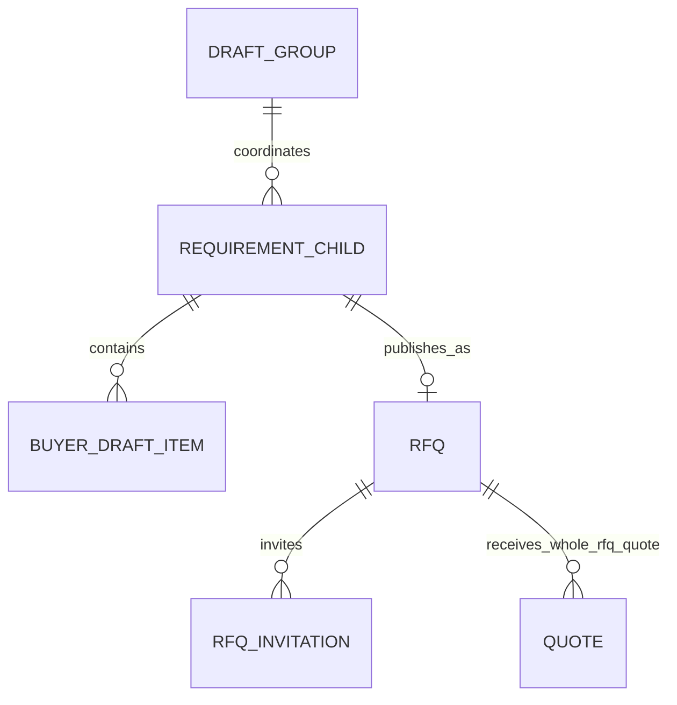

# B2-02 — Parent-Child Functional Specification

## Purpose and governing interpretation
Define customer-facing parent/child behavior under the authoritative frozen B1 rule: **one child per independently reviewable, single-category scope; each child is independently published as its own RFQ.** Earlier B2 wording that category was not a child boundary or that each child need not have its own RFQ conflicts with B1 and is not adopted.

The “parent” is a buyer-only orchestration group, not a second `requirements` procurement record. It preserves the exact original customer intent and coordinates independent child requirements. It is not a combined requirement, RFQ, publication transaction, entitlement unit, or authorization grant.

## Parent/group contract

| Concern | Proposed behavior |
|---|---|
| Create | Authenticated buyer submits exact original description; server derives creator and owner scope. Persist only after explicit intake start/save policy is agreed. |
| Ownership | Exactly one owner: organization or personal profile. Creator does not override existing organization roles. |
| Original text | Immutable source revision, buyer-only. Revisions preserve prior text and identify which parser version produced child proposals. |
| Children | Zero or more independently reviewable child requirements; each has one category, relevant subcategory, own items, review version, confirmation, publication and recovery. |
| Progress | Derived summary: total, needs clarification, ready, published, cancelled. A summary never authorizes or mutates children. |
| Completion | Derived when no active child remains in an actionable state, according to approved child cancellation policy. No parent-wide publish/confirm. |
| Cancellation | No group-wide cancellation semantics are frozen. A future child cancellation must use existing allowed lifecycle and retain audit/history. |
| Amendments | Source-text correction creates a new revision and reconciliation proposals; it never silently rewrites confirmed/published children. |
| Historical visibility | Buyer scope can recover parent and authorized children; suppliers receive neither group ID nor parent history. |

## Child contract

- A child is an ordinary `requirements` row linked to the orchestration group by a proposed nullable relationship; legacy rows remain ungrouped.
- One child represents one independently reviewable, single-category procurement scope. Different products/services can be line items within that scope; unrelated scopes become separate children even if same category. Ambiguity blocks readiness and asks the customer.
- Category/subcategory IDs must be loaded from the authoritative active taxonomy. A subcategory must belong to the selected category. Unclassified children remain unresolved; no fallback.
- Every child independently saves, reviews, confirms, publishes, recovers, and enters its own RFQ/discovery lifecycle.
- Stable child identity is persisted and independent of parser ordering/text position. `intent_key` is unique within parent; versions detect stale writes.
- One child may include Product, Service, and Repair item classifications when the coherent scope requires them. It does not imply per-item quote pricing.
- Mandatory facts are only those required by existing protected publish validation plus explicitly approved TELL readiness rules. Unstated quantity/unit stay null; no fabricated technical/commercial facts.
- Confirmation freezes a specific child version. A material post-confirmation change is a controlled amendment/new version, never overwrite.
- Cancellation/archival must follow existing procurement lifecycle and retain buyer/audit visibility. No new terminal status is assumed to exist.

## Grouping intelligence

1. Extract candidate facts and scope phrases while retaining evidence and provenance.
2. Group only products/services/repairs that form one coherent independently reviewable scope.
3. Split unrelated procurement scopes into independently reviewable children; every child is constrained to exactly one category. Category is a mandatory child boundary, while scope coherence determines whether same-category requests belong together.
4. Keep related line items together even where subcategories differ, provided the scope remains one category.
5. Same category does not justify merging unrelated scopes; distinct activities do not justify splitting one coherent scope.
6. Exact semantic duplicates may be surfaced for review; do not silently sum quantities, remove distinct specifications, or collapse conflicting lines.
7. Missing classification, uncertain relationship, or uncertain category produces clarification, not a guessed child.
8. Customer corrections supersede parser proposals but preserve prior source/version history. Splitting/merging already-confirmed children requires explicit review and controlled amendments; never silently republish.

## Proposed relation diagram

`DRAFT_GROUP`, `BUYER_DRAFT_ITEM`, and the relation are conceptual names, not claims about existing tables. The buyer-item structure is conditional on B2-01 schema evidence.

## Dependencies and risks
- Existing `requirements`/`rfqs` relation is one RFQ per requirement (`00002_core_tables.sql`); reuse it for child publication.
- No parent or child schema was found.
- **BLOCKED:** determine whether `requirement_specifications` is a reusable buyer-side item source before proposing final schema.
- Parent cancellation policy, child cancellation behavior, and post-publication amendment compatibility need engineering review against the effective lifecycle; do not invent states.
- **Status:** functionally consistent with frozen B1; dependent schema details remain blocked.
