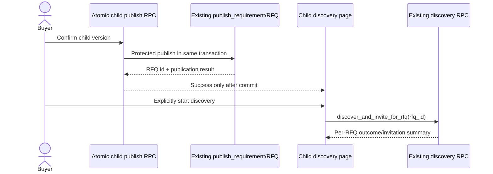

# B2-05 — Supplier Discovery Integration Contract

## Purpose and verified lifecycle
Preserve OTP discovery, invitations, identity masking, and whole-RFQ quoting while binding each discovery to one successfully published child version.

**VERIFIED tracked path:** successful publish currently navigates from `RequirementIntakePage.tsx` to `/requirements/:requirementId/discover` (`App.tsx`). `DiscoverSuppliersPage` loads context/pool on mount but calls discovery only on explicit buyer action. Its load path does call `ensureRfqForRequirement`, which can directly insert a missing RFQ; TELL must bypass that fallback by requiring the RFQ returned from atomic publication.

`runExplicitSupplierDiscovery` in `apps/web/src/features/requirement/api/rfq-lifecycle.ts` runs OTP-registered search first, checks matches, then Google Places. RPC `discover_and_invite_for_rfq` is scoped to one RFQ. Tracked migration 00251 covers fresh PIN coverage and OTP/GST fallback distinctions, prevents duplicate `(rfq_id, supplier_id)` invitations by checking existing records, and opens a DRAFT RFQ when invitations exist. Migration 00282 patches the discovery function to buyer-scope membership. Actual deployed behavior is **NOT VERIFIED**.

The latest tracked `rfqs_supplier_masked` view in migration 00329 joins the exact invitation/RFQ and filters by `private.is_supplier_user_for(ri.supplier_id)`, but the view definition itself has no explicit RFQ lifecycle predicate and exposes `req.description`, `req.attributes`, `req.quality`, and `req.commercial`. This is a material TELL allowlist/privacy review requirement; UI identity scrubbing is not a database security boundary. Whether current invitations can expose draft RFQs through this view is **REQUIRES RUNTIME VALIDATION**.

## Proposed contract

1. **Publication:** child version is immutable and published through existing protected lifecycle; return exact `rfq_id`, `requirement_id`, version, and public reference.
2. **Eligibility:** only the explicitly confirmed/published child version is a discovery source. No parent-wide or sibling aggregation.
3. **Buyer action:** customer chooses to start discovery for that child. No page-mount or group event triggers it.
4. **Matching:** reuse existing taxonomy/capability, trust-tier, location/PIN, and source-specific matching mechanisms. Do not invent a parallel supplier taxonomy.
5. **Invitation:** existing invitation lifecycle and identity aliasing apply to the exact RFQ. Migration `00002` defines unique `(rfq_id, supplier_id)` on invitations; discovery also checks for an existing invitation. Duplicate prevention must retain both protections.
6. **Progress:** surface status based on persisted invitations/coverage outcomes, distinguish no results, provider unavailable/stale coverage, and retryable failures. Never imply suppliers were contacted when no invitation/workflow occurred.
7. **Retry:** retry the same child RFQ; existing invitations are reused/skipped. Persist attempt status/idempotency if B2 schema evidence supports it. Provider-specific side effects require their existing deduplication contract.
8. **Quotation:** one whole-RFQ quote per invited supplier; no per-item pricing, partial bids, or child-to-PO automation. Existing comparison/award/PO sequence stays unchanged.
9. **Amendment:** material post-publication change creates an explicit new child version and revalidation path. Do not silently mutate the version suppliers have seen. Whether amendment reopens same RFQ or creates a new RFQ is **UNRESOLVED** until current RFQ lifecycle compatibility is validated.

## Lifecycle diagram

## Boundaries and gaps
- Discovery must not happen inside publication transaction; it may involve external coverage/provider processing and is independently retryable.
- Existing page's `ensureRfqForRequirement` fallback is incompatible with TELL's fail-closed routing requirement.
- Existing discovery RPC's real production provider behavior, invitation dispatch side effects, and retries cannot be validated without runtime approval.
- Supplier-view lifecycle gating and the privacy of free-text/JSON fields cannot be established from the UI; the view/RLS contract must be validated independently.
- Supplier discovery completion is not quote receipt, award, or purchase order creation.
- **Status:** integration contract proposed; deployed/runtime behavior not verified.
